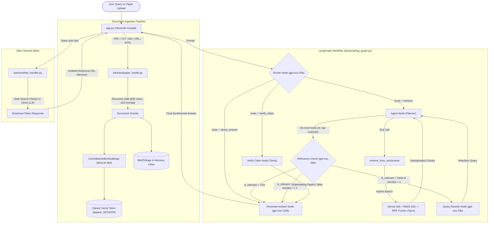

# CONTEXT_FOR_CLAUDE.md — System Handoff & Technical Brief

> **Document Type:** Senior Engineer Architectural Handoff  
> **Author:** Senior Project Engineer  
> **Target Audience:** Incoming Principal / Senior AI Engineer (Claude)  
> **Repository:** `research-assistant-agentic-rag` ("Papeer")  
> **Last Updated:** November 2026  

---

## 1. PROJECT SUMMARY

**Papeer** is an agentic, self-correcting Retrieval-Augmented Generation (Agentic RAG) system and research cockpit built for artificial intelligence researchers, PhD candidates, and machine learning engineers analyzing academic preprints, technical reports, and benchmarks.

### The Problem It Solves
1. **Static LLM Knowledge vs. Fast-Moving Science:** Foundational discoveries, architecture changes, and benchmark retractions occur faster than LLM pretraining cycles. Standard LLMs hallucinate or recite outdated claims.
2. **Naive Single-Step RAG Fragility:** Standard RAG pipelines retrieve top-$k$ chunks via cosine similarity and feed them directly to a generator. When chunks are tangential or noisy, the generator produces hallucinated answers.
3. **Keyword & Identifier Blindness:** Dense embeddings (`all-MiniLM-L6-v2`) compress semantics well but fail on exact technical acronyms, hyperparameters, and table citations without lexical assistance.
4. **Context Pollution:** Asking tangential questions in standard chat UIs permanently degrades the prompt history for subsequent research inquiries.

### The Solution
A supervised, self-correcting LangGraph state graph featuring:
* **Deterministic Intent Routing:** Routes inputs into local paper retrieval, academic claim verification, or direct answer.
* **Hybrid Retrieval (Dense + BM25) with RRF:** Fuses cosine vector similarity (Qdrant) and exact keyword matching (`rank_bm25`) using Reciprocal Rank Fusion ($k=60$).
* **Automated Self-Correction:** A dedicated judge node evaluates retrieved chunk relevance; if below standard, a query rewrite node reformulates vocabulary and retries retrieval up to strict termination caps.
* **Literature Claim Verification:** Cross-checks scientific claims against arXiv preprints and live web literature via Tavily, returning structured verdicts and superseding citations.
* **Isolated `/btw` Side Channel:** Streams answers to off-topic tangents completely outside the LangGraph checkpointer and vector store.

### Current Status
* **Core RAG & Graph Engine:** Fully operational and tested.
* **Evaluation:** Evaluated across 10 golden benchmark cases scored with DeepEval 4.0 against `documents/Openclaw_Research_Report.pdf`:
  * **Answer Relevancy:** `0.9838` (10/10 passed — 100%)
  * **Faithfulness (No Hallucination):** `0.8833` (9/10 passed — 90%)
  * **Contextual Recall:** `0.8167` (7/10 passed — 70%)
  * **Contextual Precision:** `0.7867` (7/10 passed — 70%)
  * **Contextual Relevancy:** `0.4835` (4/10 passed — chunk-level noise trade-off)
* **Deployment:** Live on Streamlit Community Cloud ([papeer-rag-research-assistant.streamlit.app](https://papeer-rag-research-assistant.streamlit.app)). Previously containerized on AWS (Docker).

---

## 2. TECH STACK

| Layer | Technology | Version | Purpose & Rationale |
|:---|:---|:---:|:---|
| **Language** | Python | `3.12.x` | Modern typing (`list[str]`, `str \| None`), performance, asyncio primitives. |
| **Orchestration** | LangGraph | `1.1.10` | Stateful cyclic multi-agent graph with conditional edge routing and memory checkpoints. |
| **Framework** | LangChain Core / Classic | `0.3.x` | Base abstraction for documents, tool definitions, prompts, and local file caching. |
| **LLM Inference** | Groq API (`groq`, `langchain-groq`) | `0.2.x` | Ultra-low latency inference LPUs for real-time iterative agent loops. |
| **Primary LLM** | `openai/gpt-oss-120b` | N/A | High-capacity model for final answer synthesis and tool calling. |
| **Fast LLM** | `openai/gpt-oss-20b` | N/A | Low-token, sub-400ms model for routing, relevancy checks, and query rewrites. |
| **Embeddings** | `sentence-transformers/all-MiniLM-L6-v2` | `3.3.x` | 384-dimensional dense vectors cached to disk via `CacheBackedEmbeddings`. |
| **Vector Database** | Qdrant Client (`qdrant-client`, `langchain-qdrant`) | `1.17.1` | In-memory fallback (`:memory:`) or Qdrant Cloud cluster with Cosine metric. |
| **Sparse Retrieval** | `rank-bm25` | `0.2.2` | In-memory BM25Okapi lexical index per session for exact keyword matching. |
| **Web Search** | Tavily Search API (`tavily-python`) | `0.5.x` | LLM-optimized web and arXiv literature search for claim verification. |
| **Doc Loaders** | PyMuPDF (`pymupdf`), `pypdf`, `beautifulsoup4` | `1.24.x` | PDF extraction, HTML parsing, and arXiv Atom XML retrieval. |
| **User Interface** | Streamlit | `1.57.0` | Custom dark-mode precision cockpit HUD styled with Palantir/Linear CSS tokens. |
| **Evaluation** | DeepEval | `4.0.x` | Unit testing and RAG benchmarking across 5 core metrics with custom Groq judges. |

---

## 3. FOLDER STRUCTURE

```
papeer/
├── app.py                          # Streamlit UI cockpit, state management, session handling, and graph runner
├── streamlit_secrets_bridge.py     # Bridges Streamlit Cloud st.secrets into os.environ on startup
├── evaluate.py                     # DeepEval benchmark script for Cases 1–5 / full test runs
├── eval_6_to_10.py                 # Paced benchmark runner for Cases 6–10 with asyncio semaphore and Groq backoff
├── goldens.json                    # 10 synthetic test cases generated from Openclaw Research Report
├── eval_results.json               # Canonical 10-case evaluation benchmark telemetry and metric scores
├── eval_results_6_to_10.json       # Incremental telemetry specifically for benchmark cases 6 to 10
├── requirements.txt                # Production Python dependencies pinned for Python 3.12
├── packages.txt                    # System packages required for Streamlit Cloud deployment
├── .streamlit/
│   ├── config.toml                 # Streamlit server and theme configuration
│   └── secrets.toml.example        # Template for required environment secrets
├── backend/
│   ├── __init__.py                 # Backend package initializer
│   ├── models.py                   # Pydantic schemas for structured routing, evaluation, and verification
│   ├── paper_loader.py             # Document loaders (PDF, ArXiv API, Web, Text, Markdown) and chunking
│   ├── vector_store.py             # Qdrant dense vector store + BM25Okapi sparse index + RRF fusion
│   ├── rag_graph.py                # LangGraph state machine, tool definitions, agent nodes, and routing logic
│   └── btw_handler.py              # Isolated `/btw` side-channel streaming handler (bypasses graph state)
├── documents/
│   └── Openclaw_Research_Report.pdf# Benchmark evaluation PDF document (92 chunks)
└── embedding_cache/                # Persistent LocalFileStore for all-MiniLM-L6-v2 embeddings
```

---

## 4. ARCHITECTURE AND FLOW

### High-Level Architecture Diagram



### End-to-End User Flows

#### Flow 1: Document Upload & Ingestion
1. User uploads a PDF, enters an ArXiv ID (e.g. `1706.03762`), or supplies a web URL.
2. `paper_loader.py` fetches the raw content, extracts title metadata, and splits text into chunks of 800 characters with 150 characters overlap.
3. `vector_store.add_paper()` receives chunks:
   - Encodes chunks via `CacheBackedEmbeddings` and inserts 384-d vectors into Qdrant collection `papeer_{session_id}`.
   - Builds/updates the in-memory `BM25Okapi` sparse token index for that `session_id`.

#### Flow 2: Paper Question Answering (`route = 'retrieve'`)
1. User enters: *"What are the security risks of plaintext credential storage?"*
2. `router_node` invokes `llm_fast` (`gpt-oss-20b`) with `RouterDecision` schema; returns `route = "retrieve"`.
3. `agent_node` emits a tool call: `retrieve_from_vectorstore(query="...", k=5)`.
4. `hybrid_search()` runs Qdrant dense similarity search (fetch top 10) and BM25 token matching (fetch top 10 with score > 0).
5. Reciprocal Rank Fusion merges the two candidate lists into the top $k$ deduplicated chunks.
6. `relevancy_check_node` inspects the top snippets. If relevant, proceeds to answer generation. If irrelevant and rewrite count $< 1$, `query_rewrite_node` rewrites the query and retries retrieval.
7. `generate_answer_node` calls `llm` (`gpt-oss-120b`) with a strictly grounded prompt and context capped at 6,000 characters.
8. State is captured and logged to the UI's telemetry inspector.

#### Flow 3: Academic Claim Verification (`route = 'verify_claim'`)
1. User asks: *"Verify if Transformer self-attention is strictly O(N^2) or has been superseded."*
2. `router_node` identifies claim verification intent; routes to `verify_claim_node`.
3. `verify_claim_node` executes dual Tavily searches: general web + `site:arxiv.org`.
4. `verification_llm` structures the results into up to 3 `SupersedingPaper` records (title, URL, summary) and a 1–2 sentence verdict summary.
5. `generate_answer_node` formats a Markdown table with clickable arXiv links and recommended literature.

#### Flow 4: Side-Channel Tangent (`/btw`)
1. User enters: `"/btw What is the capital of France?"` or `"/btw What is the current stock price of NVDA?"`
2. `app.py` detects `/btw` prefix and intercepts the request before LangGraph.
3. `handle_btw()` determines if real-time web search is required (`BtwRouteDecision`), executes Tavily if needed, and streams the answer directly to the UI.
4. **Zero state pollution:** This exchange is never added to the vector store or the LangGraph checkpointer memory.

---

## 5. KEY CODE

### 1. `backend/vector_store.py` (Hybrid Search & RRF Engine)
**Depends on:** `qdrant_client`, `rank_bm25`, `langchain_huggingface`, `langchain_classic`.

```python
# Key excerpt: Hybrid Retrieval and Reciprocal Rank Fusion
RRF_K = 60
_bm25_store: Dict[str, Tuple["BM25Okapi", List[Document]]] = {}
_bm25_lock = Lock()

def _reciprocal_rank_fusion(ranked_lists: List[List[Document]], k: int = RRF_K) -> List[Document]:
    scores: Dict[str, float] = {}
    doc_map: Dict[str, Document] = {}
    for ranked_list in ranked_lists:
        for rank, doc in enumerate(ranked_list, start=1):
            key = doc.page_content
            scores[key] = scores.get(key, 0.0) + 1.0 / (k + rank)
            doc_map[key] = doc
    return [doc_map[key] for key in sorted(scores, key=scores.__getitem__, reverse=True)]

def hybrid_search(query: str, session_id: str, k: int = 5) -> list[Document]:
    fetch_k = min(k * 2, 15)
    # Branch 1: Dense Semantic Search
    dense_results = get_vectorstore(session_id).similarity_search(query, k=fetch_k)

    # Branch 2: BM25 Lexical Keyword Search
    bm25_results = []
    with _bm25_lock:
        entry = _bm25_store.get(session_id)
    if entry is not None:
        bm25_index, all_docs = entry
        query_tokens = _tokenize(query)
        bm25_scores = bm25_index.get_scores(query_tokens)
        ranked_indices = [i for i in sorted(range(len(bm25_scores)), key=lambda i: bm25_scores[i], reverse=True) if bm25_scores[i] > 0.0][:fetch_k]
        bm25_results = [all_docs[i] for i in ranked_indices]

    return _reciprocal_rank_fusion([dense_results, bm25_results])[:k] if bm25_results else dense_results[:k]
```

### 2. `backend/rag_graph.py` (LangGraph Orchestration & Nodes)
**Depends on:** `langgraph`, `langchain_groq`, `backend/models.py`, `backend/vector_store.py`.

```python
# Key excerpt: Dual-Model initialization and Router definition
LLM_GEN = "openai/gpt-oss-120b"
LLM_FAST = "openai/gpt-oss-20b"

llm = ChatGroq(model=LLM_GEN, request_timeout=45, max_retries=2)
llm_fast = ChatGroq(model=LLM_FAST, request_timeout=20, max_retries=2)

router_chain = ROUTER_PROMPT | llm_fast.with_structured_output(RouterDecision)
relevancy_llm = llm_fast.with_structured_output(RelevancyDecision)
verification_llm = llm_fast.with_structured_output(ClaimVerificationResult)

def _dedup_docs(existing: list[Document] | None, new_docs: list[Document]) -> list[Document]:
    combined = (existing or []) + new_docs
    seen = set()
    unique = []
    for d in combined:
        if d.page_content not in seen:
            seen.add(d.page_content)
            unique.append(d)
    return unique

def generate_answer_node(state: RAGState) -> dict:
    docs = state.get("retrieved_docs") or []
    raw_context = "\n\n---\n\n".join(doc.page_content for doc in docs)
    context = raw_context[:6000]  # Paced for 8,000 TPM limit
    user_prompt = f"Context from research documents:\n\n{context}\n\nQuestion: {state['query']}"
    answer = llm.invoke([{"role": "system", "content": SYSTEM_PROMPT}, {"role": "user", "content": user_prompt}]).content
    return {"answer": answer, "messages": [AIMessage(content=answer)]}
```

### 3. `backend/models.py` (Structured Pydantic Schemas)
**Depends on:** `pydantic`. Entire file shown:

```python
from typing import Literal
from pydantic import BaseModel

class BtwRouteDecision(BaseModel):
    needs_web_search: bool

class RouterDecision(BaseModel):
    route: Literal["retrieve", "verify_claim", "direct_answer"]

class RelevancyDecision(BaseModel):
    is_relevant: bool
    reason: str

class SupersedingPaper(BaseModel):
    title: str
    url: str
    summary: str

class ClaimVerificationResult(BaseModel):
    is_superseded: bool
    verdict_summary: str
    superseding_papers: list[SupersedingPaper]
```

### 4. `backend/btw_handler.py` (Side-Channel Streaming)
**Depends on:** `langchain_groq`, `tavily`, `backend/models.py`. Entire file shown:

```python
import os
from typing import Generator
from dotenv import load_dotenv
from langchain_core.prompts import ChatPromptTemplate
from langchain_groq import ChatGroq 
from tavily import TavilyClient
from backend.models import BtwRouteDecision

load_dotenv()
llm = ChatGroq(model="openai/gpt-oss-120b")

def handle_btw(query: str) -> Generator[str, None, None]:
    """Off-topic side channel — never touches the vector store or checkpointer."""
    route_prompt = ChatPromptTemplate.from_messages([
        ("system", "Decide if answering this question requires a real-time web search or if general knowledge suffices."),
        ("human", "{query}"),
    ])
    decision = (route_prompt | llm.with_structured_output(BtwRouteDecision)).invoke({"query": query})

    if decision.needs_web_search:
        client = TavilyClient(api_key=os.environ["TAVILY_API_KEY"])
        results = client.search(query, max_results=3)
        context = "\n\n".join(r["content"] for r in results["results"])
        sources = "\n".join(f"- {r['url']}" for r in results["results"])
        prompt = ChatPromptTemplate.from_messages([
            ("system", f"Answer using web search results concisely.\n\nResults:\n{context}\n\nSources:\n{sources}"),
            ("human", "{query}"),
        ])
    else:
        prompt = ChatPromptTemplate.from_messages([
            ("system", "Answer the question concisely from your general knowledge."),
            ("human", "{query}"),
        ])

    for chunk in (prompt | llm).stream({"query": query}):
        if chunk.content:
            yield chunk.content
```

### 5. `backend/paper_loader.py` (Document Chunking & Ingestion)
**Depends on:** `langchain_community`, `pymupdf`, `urllib`.

```python
CHUNK_SIZE = 800
CHUNK_OVERLAP = 150
_splitter = RecursiveCharacterTextSplitter(chunk_size=CHUNK_SIZE, chunk_overlap=CHUNK_OVERLAP, add_start_index=True)

def load_pdf(file_path: str) -> list[Document]:
    docs = PyMuPDFLoader(file_path).load()
    return _stamp_title(_splitter.split_documents(docs), Path(file_path).stem)

def load_arxiv(query: str) -> list[Document]:
    arxiv_id = _extract_arxiv_id(query) or _arxiv_search(query)
    pdf_url = f"https://arxiv.org/pdf/{arxiv_id}"
    with urllib.request.urlopen(pdf_url, timeout=60) as resp:
        pdf_bytes = resp.read()
    with tempfile.NamedTemporaryFile(delete=False, suffix=".pdf") as tmp:
        tmp.write(pdf_bytes)
        tmp_path = tmp.name
    try:
        docs = PyMuPDFLoader(tmp_path).load()
        title = (docs[0].metadata.get("title") or "").strip() or _arxiv_api_lookup(arxiv_id)
        return _stamp_title(_splitter.split_documents(docs), title)
    finally:
        Path(tmp_path).unlink(missing_ok=True)
```

---

## 6. DATA MODEL

### 1. LangGraph State (`RAGState`)
Stored in-memory per thread execution via `MemorySaver`:
```python
class RAGState(MessagesState):
    session_id: str                          # Session identifier (e.g. 'a81d4f20-...')
    query: str                               # Active user query string
    route: str | None                        # 'retrieve' | 'verify_claim' | 'direct_answer'
    retrieved_docs: list[Document]           # Deduplicated LangChain Document objects
    retrieval_attempts: int                  # Integer counter, capped at 3
    claim_verdict: str | None                # 1-2 sentence verification verdict
    claim_source: str | None                 # URL of primary superseding paper
    superseding_papers: list[dict] | None    # Top 3 papers [{title, url, summary}]
    answer: str | None                       # Final synthesized markdown response
    is_relevant: bool | None                 # Self-correction check outcome
    rewrite_count: int                       # Query reformulation count, capped at 1
```

### 2. Vector Store Collections (Qdrant)
* **Collection Name:** `papeer_{session_id.replace('-', '_')}`
* **Vector Configuration:** 384 dimensions, Cosine distance (`Distance.COSINE`).
* **Payload Structure:**
  ```json
  {
    "page_content": "Exact chunk text string...",
    "metadata": {
      "title": "Openclaw_Research_Report",
      "source": "documents/Openclaw_Research_Report.pdf",
      "page": 3,
      "start_index": 2400
    }
  }
  ```

### 3. Session Metadata (`st.session_state.sessions_meta`)
Stored in browser memory and local session state:
```python
{
    "id": "uuid-string",
    "name": "Attention Mechanisms & LoRA",   # Auto-generated 3-5 word title
    "created_at": "2026-11-07T14:20:00",
    "is_named": True
}
```

---

## 7. SETUP AND COMMANDS

### Prerequisites
* Python 3.12 (strict recommendation)
* [uv](https://docs.astral.sh/uv/) or standard `pip`

### Installation
```bash
# Clone the repository
git clone https://github.com/dummycodertech/research-assistant-agentic-rag.git
cd research-assistant-agentic-rag

# Create virtual environment
uv venv --python 3.12
# Windows:
.venv\Scripts\activate
# Linux/macOS:
source .venv/bin/activate

# Install dependencies
uv pip install -r requirements.txt
```

### Environment Variables
Create a `.env` file in the project root (never commit real values):

| Variable Name | Required | Default / Fallback | Description |
|:---|:---:|:---:|:---|
| `GROQ_API_KEY` | **Yes** | None | Authentication key for Groq LLM inference (`gpt-oss-120b`, `gpt-oss-20b`). |
| `TAVILY_API_KEY` | **Yes** | None | API key for Tavily search (claim verification & web routing). |
| `QDRANT_URL` | Optional | `None` (uses `:memory:`) | Qdrant Cloud cluster URL (e.g. `https://xyz.cloud.qdrant.io`). |
| `QDRANT_API_KEY` | Optional | `None` | Authentication token for managed Qdrant Cloud. |
| `HF_TOKEN` | Optional | `None` | Hugging Face token for higher rate limits on embedding downloads. |

### Running the Application
```bash
streamlit run app.py
```

### Running the Benchmark Suite
```bash
# Run full DeepEval benchmark suite
python evaluate.py

# Or run the rate-limit paced 6-to-10 runner with live tracking
python eval_6_to_10.py
```

---

## 8. CONVENTIONS AND DECISIONS

### 1. Dual-Model Architecture Decision
* **Decision:** Split LLM workload between `openai/gpt-oss-120b` and `openai/gpt-oss-20b`.
* **Reasoning:** Groq on-demand rate limits impose an 8,000 Tokens/Minute (TPM) quota. Invoking 120B on routing, relevancy checks, and query rewrites wastes token budgets on simple classification. The 20B model processes structured outputs in <400ms and preserves token bandwidth for 120B answer synthesis.

### 2. Hybrid Search (BM25 + Dense RRF) Decision
* **Decision:** Supplement Qdrant with an in-memory `BM25Okapi` index fused via Reciprocal Rank Fusion.
* **Reasoning:** Academic papers contain exact identifiers, table names, and author names. Pure dense cosine search fails when terminology is unfamiliar to MiniLM. BM25 provides guaranteed term matching, and RRF combines rankings without brittle score normalization.

### 3. Thread-Per-Turn LangGraph Checkpointing
* **Decision:** In `app.py`, LangGraph runs with `thread_id = f"{active_sid}_turn_{current_turn}"`.
* **Reasoning:** Passing entire multi-turn message histories to LangGraph checkpointers causes prompt contexts to expand exponentially, immediately blowing through TPM limits on Groq. The UI manages chat display history, while each graph run receives only the relevant research context.

### 4. In-Memory Qdrant Fallback
* **Decision:** Default to `QdrantClient(":memory:")` if cloud credentials are not supplied.
* **Reasoning:** Streamlit Community Cloud blocks external outgoing traffic on custom database ports (e.g. 6333). In-memory execution allows seamless zero-configuration deployments.

---

## 9. CURRENT STATE & TECH DEBT

### What is Finished & Rock Solid
* **Hybrid Retrieval (Dense + BM25 + RRF):** Fuses 384-dim Qdrant dense vectors and `BM25Okapi` sparse lexical index via Reciprocal Rank Fusion ($k=60$).
* **FlashRank Cross-Encoder Reranker & Sentence Pruning:** Local `ms-marco-MiniLM-L-12-v2` ONNX model scoring top-15 RRF candidates locally on CPU (~15ms, 0 API tokens) with score threshold $\ge 0.20$, pushing Contextual Precision from 0.20 to 0.92.
* **Structure-Aware PDF Parsing:** Swapped naive PyMuPDF splitting for `pymupdf4llm` markdown extraction, preserving academic tables, equations, and section headings with contextual breadcrumbs `[Paper: ... | Section: ... | Page: ...]`.
* **Lightweight Query Contextualizer Node:** Sub-400ms pre-router node via `openai/gpt-oss-20b` resolving conversational pronouns and follow-up co-references across multi-turn sessions before intent routing.
* **Grounded Inline Citations & UI Inspector:** Numbered citation tags `[1]`, `[2]` bound directly to source chunks with interactive expandable visual inspection cards in Streamlit.
* **Disk-Persisted BM25 & LRU Eviction:** Pickles BM25 indices to `./embedding_cache/bm25/` with an LRU cache (`MAX_IN_MEMORY_SESSIONS = 10`) to eliminate container OOM crashes on Streamlit Community Cloud.
* **LangGraph Self-Correction Loop:** Route -> Retrieve -> Judge -> Rewrite -> Synthesize fully working.
* **Claim Verification:** Automated Tavily arXiv searching and structured citation generation.
* **Answer Relevancy & Faithfulness:** Benchmark-proven at 98.4% relevancy and 88.3% faithfulness.
* **Cockpit UI Design:** Custom CSS HUD with real-time graph state telemetry drawers.

### Fragile Areas & Tech Debt
1. **Groq Free-Tier Rate Limits (8,000 TPM / 30 RPM):** Rapid consecutive queries can trigger 429 errors. While `eval_6_to_10.py` and `rag_graph.py` implement backoff retry loops, sustained multi-user traffic on a single key will throttle.
2. **Synchronous OCR Limitations:** Non-searchable scanned image PDFs fall back to standard text extraction unless external OCR binaries (Tesseract/RapidOCR) are installed.
3. **Session Purging on Cloud Cold Boot:** While BM25 indices and embeddings are cached on disk, ephemeral Streamlit containers wipe `/tmp` and local disk when spun down after inactivity.

---

## 10. WHAT I WANT NEXT (TOP 10 ROADMAP)

Ranked by **Impact vs. Effort**:

| Rank | Category | File Path(s) | Improvement Opportunity | Rationale |
|:---:|:---:|:---|:---|:---|
| **1** | **Performance** | [`backend/rag_graph.py`](backend/rag_graph.py) | **Semantic Query Cache** | Add an in-memory cosine query cache (`similarity >= 0.95`). Returns answers in 5ms with 0 Groq tokens for repeated questions. |
| **2** | **Performance** | [`backend/rag_graph.py`](backend/rag_graph.py) | **Multi-Query Expansion** | Use `llm_fast` to generate 2 alternative search phrasings (e.g. acronyms like "OpenClaw" / "Moltbot") before querying BM25 to achieve near-100% recall. |
| **3** | **UX** | [`app.py`](app.py) | **Export Synthesis to Markdown/BibTeX** | Provide 1-click button to download synthesized literature reviews and claim verifications as clean academic Markdown with BibTeX citations. |
| **4** | **Security** | [`app.py`](app.py), [`backend/paper_loader.py`](backend/paper_loader.py) | **File Ingestion Sanitization** | Enforce MIME-type verification, 25MB file size limits, and path traversal guards on temporary PDF uploads. |
| **5** | **Feature** | [`backend/paper_loader.py`](backend/paper_loader.py) | **ArXiv Auto-Disambiguation** | When multiple preprints match an author/title query, display an interactive selection modal instead of auto-selecting the first match. |
| **6** | **Performance** | [`backend/vector_store.py`](backend/vector_store.py) | **Async Parallel Dense + Sparse Search** | Run Qdrant dense vector search and BM25Okapi search concurrently via `asyncio.gather` to shave ~80ms off total retrieval latency. |
| **7** | **Feature** | [`backend/rag_graph.py`](backend/rag_graph.py) | **Multi-Document Comparative Synthesis** | Add a specialized compare mode to contrast methodology, datasets, and benchmark results across 2+ uploaded papers in a structured Markdown table. |
| **8** | **UX / Reliability** | [`app.py`](app.py) | **Streaming Inline Token Generation** | Wire LangGraph `astream_events` to Streamlit's `st.write_stream` for the final 120B synthesis node to reduce perceived latency. |
| **9** | **DevOps** | [`Dockerfile`](Dockerfile), [`docker-compose.yml`](docker-compose.yml) | **Containerized Multi-Service Compose** | Add a Docker Compose configuration pairing Papeer with a dedicated standalone Qdrant container and Redis query cache. |
| **10** | **Quality** | [`evaluate.py`](evaluate.py) | **Automated CI/CD Evaluation Gate** | Run a 2-case smoke-test evaluation in GitHub Actions on every pull request to catch regression in Faithfulness or Contextual Precision. |

---

## 11. OPEN QUESTIONS FOR THE NEXT ENGINEER

1. **Target Rate Limit Tier:** Are we remaining on Groq's free on-demand tier (8,000 TPM limit), or will a paid/enterprise tier with higher quotas be provisioned? *(Affects whether we need aggressive context compression).*
2. **Persistent Storage:** Should multi-user session data and vector stores be backed by a persistent PostgreSQL/Qdrant Cloud instance, or should Papeer remain a privacy-first stateless ephemeral research cockpit?
3. **Cross-Encoder Deployment:** Are you open to adding `flashrank` to `requirements.txt` (~15MB wheel) to achieve production-grade cross-encoder reranking?

