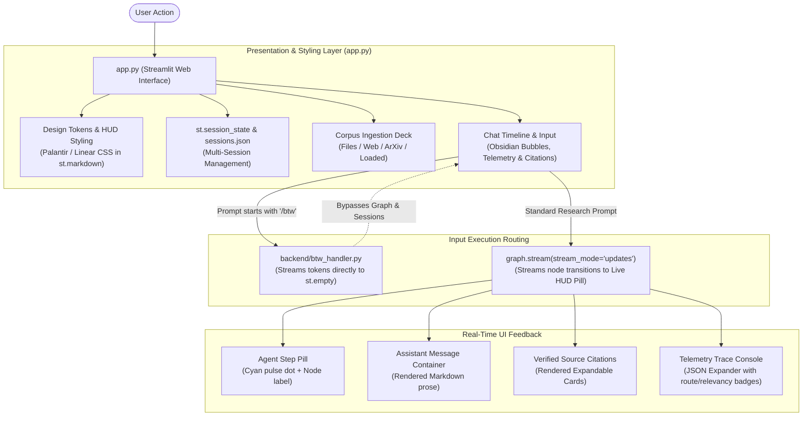

# CONTEXT_FOR_GEMINI.md — Frontend Architecture & UI Cockpit Handoff

> **Document Type:** Senior Frontend / Full-Stack Engineer Architectural Handoff  
> **Author:** Senior Project Engineer  
> **Target Audience:** Incoming Principal / Senior AI Engineer (Gemini)  
> **Repository:** `research-assistant-agentic-rag` ("Papeer")  
> **Specialization:** Presentation Layer, Design System, Streamlit Reactive State, and Frontend Enhancements  
> **Last Updated:** November 2026  

---

## 1. PROJECT SUMMARY

**Papeer** is an agentic research cockpit and literature analysis web application designed for AI researchers, graduate students, and machine learning engineers analyzing academic preprints, technical whitepapers, and benchmark reports.

### The Problem It Solves
1. **Cluttered, Generic Chat Interfaces:** Traditional LLM chat UIs treat scientific analysis like casual messaging, obscuring document provenance, retrieved passage boundaries, and confidence indicators.
2. **Black-Box RAG Anxiety:** Users of standard RAG applications cannot see *why* an assistant answered the way it did, whether it retrieved the right paper sections, or if it attempted query self-correction.
3. **Unverifiable Citations:** LLMs routinely hallucinate academic footnotes (`[1]`, `[Smith et al.]`) that do not map to real page numbers or exact text passages.
4. **Context Window Contamination:** Tangential or off-topic inquiries (e.g. *"explain softmax"*, *"what is the weather?"*) pollute research conversation history, permanently degrading subsequent domain-specific queries.

### The Frontend Solution
A high-density, dark-mode precision engineering cockpit inspired by **Palantir Apollo**, **Linear**, and **Vercel**:
* **Autonomous Intent Routing & Architecture HUD:** Live 5-stage pipeline indicator bar (`01 INGEST` → `02 ROUTER` → `03 RETRIEVE` → `04 JUDGE` → `05 SYNTHESIS`) displaying active agent states.
* **Corpus Ingestion Deck:** Smoked glassmorphism 4-tab panel supporting drag-and-drop multi-file uploads (PDF/TXT/MD), direct web URL scraping, and official arXiv Atom API queries with live indexed document badges.
* **Verifiable Source Inspector:** Dedicated expandable source drawer rendering numbered citation cards (`[1]`, `[2]`) with exact paper titles, section headings, page numbers, and italicized quote snippets.
* **Real-Time Telemetry Trace Console:** Collapsible per-turn JSON expanders exposing live LangGraph routing decisions, relevancy classifications, retry counts, and claim verdicts.
* **Isolated `/btw` Side-Channel:** Direct token-streamed off-topic query handler that completely bypasses LangGraph state and vector store checkpointers.

### Current Status
* **Status:** Working & Deployed in Production.
* **Live URL:** [papeer-rag-research-assistant.streamlit.app](https://papeer-rag-research-assistant.streamlit.app)
* **Hosting:** Streamlit Community Cloud (connected directly to GitHub `master` branch).

---

## 2. TECH STACK

| Layer | Technology | Version | Purpose & Rationale |
|:---|:---|:---:|:---|
| **UI Framework** | Streamlit | `1.57.0` | Reactive Python presentation framework powering UI components, tabs, chat timeline, and session state. |
| **Styling Paradigm** | Scoped Raw CSS Injection | N/A | Custom dark-mode design system injected via `st.markdown('<style>...</style>', unsafe_allow_html=True)`. |
| **Typography** | Google Fonts | Web CDN | `Inter` (sans-serif body/UI), `JetBrains Mono` (telemetry/code), `Newsreader` (italicized editorial citations). |
| **Design System** | Palantir / Linear / Vercel Tokens | CSS Variables | Low-saturation obsidian backgrounds (`#06070B`), cyan accents (`#22D3EE`), cyber-indigo gradients (`#6366F1`), and glassmorphism backdrops. |
| **Secrets Management** | `streamlit_secrets_bridge.py` | Local Module | Automatically maps Streamlit Cloud `st.secrets` into `os.environ` on app initialization. |
| **Graph Orchestration** | LangGraph | `1.1.10` | Stateful cyclical multi-agent graph streamed live to the UI via `graph.stream(stream_mode="updates")`. |
| **Inference LPUs** | Groq API (`langchain-groq`) | `0.2.x` | Sub-second token generation powering `openai/gpt-oss-120b` (answer synthesis) and `openai/gpt-oss-20b` (session naming & routing). |
| **Vector Store Engine** | Qdrant Client | `1.17.1` | In-memory (`:memory:`) or Qdrant Cloud cluster with disk-cached embeddings (`CacheBackedEmbeddings`). |
| **Sparse Retrieval** | `rank-bm25` | `0.2.2` | In-memory tokenized lexical search index with disk persistence (`.pkl`) and LRU session eviction. |
| **Neural Reranking** | FlashRank | `0.2.10` | 4MB local ONNX cross-encoder (`ms-marco-MiniLM-L-12-v2`) running sub-20ms on CPU with 0 API tokens. |
| **Document Loaders** | `pymupdf4llm`, `beautifulsoup4`, `arxiv` | `2.1.0+` | Extracts structured Markdown with preserved tables, formulas, and section breadcrumbs. |

---

## 3. FOLDER STRUCTURE

```
papeer/
├── app.py                          # PRIMARY FRONTEND ENTRYPOINT: UI cockpit, CSS design tokens, chat timeline, state loops
├── streamlit_secrets_bridge.py     # Startup bridge copying st.secrets into os.environ before backend imports
├── sessions.json                   # Local persistent metadata store for multi-session chat history and session titles
├── requirements.txt                # Pinned production Python dependencies
├── packages.txt                    # Debian system dependencies for Streamlit Cloud deployment
├── .streamlit/
│   ├── config.toml                 # Streamlit server port, headless mode, and dark theme palette config
│   └── secrets.toml.example        # Template for required environment secrets (GROQ_API_KEY, TAVILY_API_KEY)
├── backend/
│   ├── __init__.py                 # Backend package marker
│   ├── models.py                   # Pydantic v2 schemas for structured routing, evaluation, and verification
│   ├── paper_loader.py             # Document parsers (PDF via pymupdf4llm, ArXiv Atom API, Web, TXT, MD)
│   ├── vector_store.py             # Qdrant vector store + BM25Okapi + FlashRank cross-encoder reranker + LRU cache
│   ├── rag_graph.py                # LangGraph state machine, tool definitions, agent nodes, and routing logic
│   └── btw_handler.py              # Isolated `/btw` side-channel streaming generator (bypasses graph state)
├── documents/
│   └── Openclaw_Research_Report.pdf# Canonical evaluation benchmark paper
├── docs/
│   └── screenshots/                # Application UI interface screenshots
└── embedding_cache/                # Disk-persisted LocalFileStore for embeddings, BM25 pickles, and FlashRank models
```

---

## 4. ARCHITECTURE AND FRONTEND FLOW

### 1. High-Level User Flow Architecture



### 2. Streamlit Reactivity & Execution Lifecycle
Streamlit executes top-to-bottom on every user interaction. The frontend maintains state and avoids infinite execution loops through the following mechanics:
1. **Initialization (`st.session_state`):**
   - `sessions_meta`: Loaded from `sessions.json` or initialized to a default session.
   - `chats`: Dictionary of `{session_id: list[dict]}` storing message history.
   - `turns`: Turn counter tracking current conversational step for per-turn thread checkpointing.
   - `active_session_id`: UUID tracking the currently viewed session in the sidebar.
2. **Ingestion Loop:**
   - Ingesting files or ArXiv IDs invokes `add_paper(docs, active_sid)`.
   - On completion, `st.session_state[f"processed_files_{active_sid}"].add(...)` updates, followed by `st.rerun()` to refresh the "Loaded Documents" tab and active corpus counter.
3. **Turn-Isolated Graph Invocations:**
   - To respect Groq's 8,000 TPM limit while maintaining conversational UI memory, each query executes with `thread_id = f"{active_sid}_turn_{current_turn}"`.
   - The last 4 turns (`recent_history`) are passed into `chat_history` so the new `contextualize_query_node` resolves pronouns without passing massive tool scratchpads.
4. **Node Transition Streaming:**
   - During graph execution, `graph.stream(input_state, config, stream_mode="updates")` yields node completion events.
   - A live HUD pill (`agent-step-pill`) displays a pulsing cyan LED and human-readable status labels (`RESOLVING CONVERSATION CONTEXT`, `ROUTING QUERY`, `PLANNING RETRIEVAL`, etc.).
   - Upon completion, the status pill is cleared (`status_placeholder.empty()`), and the synthesized response, citation cards, and telemetry expanders are rendered.

---

## 5. KEY CODE

### 1. `app.py` — Design System Tokens & HUD Global Styles
* **File:** [`app.py`](app.py#L30-L86)
* **Responsibility:** Injects the core color palette, 32px blueprint grid, aurora glow light cones, and typography.
* **Code:**
```css
:root {
  --bg-app:              #06070B;
  --bg-sidebar:          rgba(8, 10, 16, 0.94);
  --bg-surface:          rgba(13, 16, 26, 0.70);
  --bg-surface-elevated: #161824;
  --border-hairline:      rgba(255, 255, 255, 0.08);
  --border-muted:         rgba(99, 102, 241, 0.28);
  --border-active:        rgba(34, 211, 238, 0.5);
  --accent-indigo:        #6366F1;
  --accent-cyan:          #22D3EE;
  --text-primary:         #F8FAFC;
  --text-secondary:       #CBD5E1;
  --text-muted:           #64748B;
  --status-emerald:       #10B981;
  --font-sans:            'Inter', -apple-system, BlinkMacSystemFont, sans-serif;
  --font-mono:            'JetBrains Mono', monospace;
  --font-serif:           'Newsreader', Georgia, serif;
}

[data-testid="stAppViewContainer"], .stApp {
  background-color: #06070B !important;
  background-image: 
    radial-gradient(ellipse 70% 45% at 50% -10%, rgba(99, 102, 241, 0.20), transparent 70%),
    radial-gradient(ellipse 40% 30% at 85% 10%, rgba(6, 182, 212, 0.12), transparent 60%),
    linear-gradient(to right, rgba(255, 255, 255, 0.035) 1px, transparent 1px),
    linear-gradient(to bottom, rgba(255, 255, 255, 0.035) 1px, transparent 1px) !important;
  background-size: 100% 100%, 100% 100%, 32px 32px, 32px 32px !important;
  background-attachment: fixed !important;
}
```

### 2. `app.py` — Source Citations Card Renderer
* **File:** [`app.py`](app.py#L1191-L1214)
* **Responsibility:** Parses structured source metadata from `RAGState["source_citations"]` and renders branded inspection cards with page numbers, section tags, and italicized quotes.
* **Code:**
```python
def render_source_citations(citations: list[dict]):
    if not citations:
        return
    with st.expander(f"📚 VERIFIED SOURCE CITATIONS ({len(citations)})", expanded=False):
        for cit in citations:
            st.markdown(f"""
            <div style="
              background: rgba(13, 16, 26, 0.7);
              border: 1px solid rgba(34, 211, 238, 0.2);
              border-left: 3px solid #22D3EE;
              border-radius: 6px;
              padding: 8px 12px;
              margin-bottom: 8px;
            ">
              <div style="display:flex; justify-content:space-between; align-items:center; flex-wrap:wrap; gap:6px;">
                <span style="font-family:'JetBrains Mono',monospace; font-weight:700; color:#22D3EE; font-size:12px;">[{cit.get('index', 1)}] {cit.get('title', 'Document')}</span>
                <span style="font-family:'JetBrains Mono',monospace; font-size:11px; color:#94A3B8;">Section: {cit.get('section', 'General')} · Page {cit.get('page', 1)}</span>
              </div>
              <div style="font-family:'Newsreader',Georgia,serif; font-style:italic; font-size:12px; color:#CBD5E1; margin-top:5px; line-height:1.4;">
                "{cit.get('snippet', '')}..."
              </div>
            </div>
            """, unsafe_allow_html=True)
```

### 3. `app.py` — Real-Time Telemetry Trace Console
* **File:** [`app.py`](app.py#L1216-L1245)
* **Responsibility:** Extracts internal graph state flags (`route`, `is_relevant`, `rewrite_count`, `retrieval_attempts`, `claim_verdict`) and renders status badges alongside the full state JSON.
* **Code:**
```python
def render_telemetry_trace(turn_num: int, state_snapshot: dict):
    with st.expander(f"TELEMETRY TRACE · TURN {turn_num}", expanded=False):
        if state_snapshot:
            route = state_snapshot.get("route") or "retrieve"
            relevant = state_snapshot.get("is_relevant")
            rewrites = state_snapshot.get("rewrite_count", 0)
            attempts = state_snapshot.get("retrieval_attempts", 0)
            verdict = state_snapshot.get("claim_verdict")

            relevant_badge = (
                f'<span style="background:rgba(16,185,129,0.1);border:1px solid rgba(16,185,129,0.25);color:#10B981;padding:2px 8px;border-radius:4px;">relevant: True</span>'
                if relevant is True else
                f'<span style="background:rgba(245,158,11,0.1);border:1px solid rgba(245,158,11,0.25);color:#F59E0B;padding:2px 8px;border-radius:4px;">relevant: {relevant}</span>'
            )
            # Renders route badge, rewrite badge, attempts badge, and formatted JSON
            st.json(state_snapshot)
```

### 4. `app.py` — Live LangGraph Step Streaming
* **File:** [`app.py`](app.py#L1327-L1352)
* **Responsibility:** Intercepts graph node execution events and provides real-time UI feedback via a pulsing cyber-pill.
* **Code:**
```python
NODE_LABELS = {
    "contextualize_query": "RESOLVING CONVERSATION CONTEXT & CO-REFERENCES",
    "router":              "ROUTING QUERY THROUGH INTENT CLASSIFIER",
    "agent_node":          "PLANNING RETRIEVAL STRATEGY",
    "retrieval":           "HYBRID EMBEDDING & FLASHRANK RERANKING",
    "relevancy_check":     "CROSS-EXAMINING DOCUMENT RELEVANCY",
    "query_rewrite":       "REWRITING & REFINING SUB-QUERIES",
    "verify_claim":        "VERIFYING CLAIMS AGAINST ACADEMIC LITERATURE",
    "generate_answer":     "SYNTHESIZING CITATIONS & RESPONSE",
}

for updates in graph.stream(input_state, config, stream_mode="updates"):
    for node_name, node_state in updates.items():
        if node_name in NODE_LABELS:
            status_placeholder.markdown(f"""
            <div class="agent-step-pill">
              <span class="status-pulse-cyan"></span> {NODE_LABELS[node_name]}
            </div>
            """, unsafe_allow_html=True)
        if node_name == "generate_answer":
            answer = node_state.get("answer", "")
            if answer:
                response_text = answer
status_placeholder.empty()
```

### 5. `streamlit_secrets_bridge.py` — Environment Hydration Bridge
* **File:** [`streamlit_secrets_bridge.py`](streamlit_secrets_bridge.py)
* **Responsibility:** Bridges Streamlit Cloud secrets into standard `os.environ` keys before downstream backend modules initialize.
* **Code:**
```python
import os
import streamlit as st

def bridge_secrets():
    """Copy st.secrets key-values into os.environ if not already present."""
    try:
        for k, v in st.secrets.items():
            if isinstance(v, str) and k not in os.environ:
                os.environ[k] = v
    except Exception:
        pass

bridge_secrets()
```

---

## 6. DATA MODEL & STATE SCHEMAS

### 1. `st.session_state` Schema
| Key | Type | Description |
|:---|:---|:---|
| `sessions_meta` | `dict[str, dict]` | Map of session metadata objects loaded from `sessions.json`. |
| `active_session_id` | `str` | UUID string identifying the active chat session. |
| `chats` | `dict[str, list[dict]]` | Map of `{session_id: [{"role": str, "content": str, "graph_state": dict, "turn": int}]}`. |
| `turns` | `dict[str, int]` | Map of `{session_id: int}` tracking turn numbers for unique LangGraph thread checkpointing. |
| `processed_files_{sid}`| `set[str]` | Set of file names already ingested into the active session's vector collection. |

### 2. `sessions.json` Schema
```json
{
  "0f9f9c32-e2f3-4377-b57a-3758c7059013": {
    "id": "0f9f9c32-e2f3-4377-b57a-3758c7059013",
    "name": "Moltbot Security & Channel Usability",
    "created_at": "2026-11-07T16:24:12.345678",
    "is_named": true
  }
}
```

### 3. Citation Object Schema (`source_citations`)
Generated during `generate_answer` in `backend/rag_graph.py` and rendered in `app.py`:
```json
{
  "index": 1,
  "title": "Openclaw_Research_Report",
  "section": "2.2 Multi-Channel Communication Integration",
  "page": 3,
  "snippet": "Moltbot natively supports 9+ messaging platforms simultaneously (WhatsApp, Telegram, Discord, Slack...)"
}
```

---

## 7. SETUP AND COMMANDS

### Environment Variables
Set these in your local `.env` file or in Streamlit Cloud Settings under **Secrets**:
```toml
GROQ_API_KEY = "gsk_..."          # Required: Groq LPU inference
TAVILY_API_KEY = "tvly-..."        # Required: Web search and arXiv verification
QDRANT_URL = "https://..."         # Optional: Cloud Qdrant (defaults to :memory:)
QDRANT_API_KEY = "..."             # Optional: Cloud Qdrant API key
```

### Installation & Run Commands
```bash
# 1. Create and activate Python 3.12 virtual environment
python -m venv .venv
source .venv/bin/activate    # Linux/macOS
.venv\Scripts\activate       # Windows

# 2. Install pinned dependencies
pip install -r requirements.txt

# 3. Launch Streamlit Frontend Cockpit
streamlit run app.py
```

---

## 8. CONVENTIONS AND DESIGN DECISIONS

### 1. Injected Raw CSS vs. Native Streamlit Theming
* **Decision:** Global styling is handled via a massive `<style>` tag injected via `st.markdown(..., unsafe_allow_html=True)` rather than relying strictly on `.streamlit/config.toml`.
* **Reasoning:** Streamlit's native theme engine does not support glassmorphism (`backdrop-filter: blur()`), radial spotlights, custom scrollbars, glowing borders, or font pairing (`Inter` + `JetBrains Mono` + `Newsreader`). Raw CSS injection provides full control over every DOM node.

### 2. Autonomous Session Naming via `gpt-oss-20b`
* **Decision:** On the very first user message of a session, a zero-shot prompt executes against `openai/gpt-oss-20b` to generate a 3–5 word title and sets `is_named: true`.
* **Reasoning:** Avoids generic *"Chat 1"*, *"Chat 2"* labels without requiring manual user rename dialogs. Using 20B completes the title in <300ms without consuming 120B token budgets.

### 3. Per-Turn Thread Checkpointing (`thread_id = f"{sid}_turn_{turn}"`)
* **Decision:** LangGraph executes with a unique thread ID for each turn rather than accumulating in a single persistent LangGraph memory thread.
* **Reasoning:** In multi-turn research sessions, re-sending massive tool outputs (thousands of characters per retrieved paper chunk) rapidly causes token explosion, exceeding Groq's 8,000 TPM limit. The frontend manages the UI chat display, and only passes the last 4 turns (`recent_history`) to the contextualizer node.

### 4. Isolated `/btw` Side Channel
* **Decision:** Off-topic queries prefixed with `/btw` bypass LangGraph, Qdrant, and session history completely.
* **Reasoning:** Prevents casual side queries (e.g., *"What is an eigenvalue?"*) from corrupting the document vector index or polluting the research graph telemetry logs.

---

## 9. CURRENT FRONTEND STATE & KNOWN TECH DEBT

### What is Finished & Polished
* **Design System & Typography:** Complete Palantir/Linear/Vercel dark theme with cyan/indigo accent lighting and blueprint micro-grid.
* **Responsive Bento Starters:** 2x2 starter card layout with 1-click benchmark loading (`Attention Is All You Need`).
* **Source Inspector:** Expandable card drawer displaying verified citations with section breadcrumbs and italicized snippets.
* **Telemetry Inspector:** Formatted per-turn JSON inspector with color-coded status badges for route, relevancy, and verdicts.
* **Streaming Node Status:** Live cyan pulsing badge indicating active LangGraph state transitions.

### Frontend Tech Debt & Fragile Areas
1. **Full Page Rerun Flashes:** Because Streamlit reruns the entire script upon state changes, switching tabs or uploading files triggers a brief DOM repaint.
2. **Streaming Text in Graph Runs:** Currently, the final 120B answer is delivered as a complete block after the `generate_answer` node finishes. While the `/btw` handler streams token-by-token using `st.empty()`, the LangGraph research answers do not yet stream tokens via `st.write_stream`.
3. **Mobile Screen Width:** On screens under 640px, the 5-node horizontal architecture HUD (`.pipeline-hud-bar`) can cause horizontal scrollbar clipping unless wrapped.
4. **Markdown Rendering of Tables:** While `pymupdf4llm` generates clean Markdown tables, Streamlit's native markdown engine occasionally renders wide academic tables with ugly horizontal overflow.

---

## 10. WHAT I WANT NEXT (TOP 10 FRONTEND ROADMAP FOR GEMINI)

Ranked by **Impact vs. Effort**:

| Rank | Category | Target File(s) | Improvement Opportunity | Rationale |
|:---:|:---:|:---|:---|:---|
| **1** | **UX / Performance** | [`app.py`](app.py) | **Token Streaming for LangGraph Answers** | Wire LangGraph `astream_events` to Streamlit's `st.write_stream` during `generate_answer` to display tokens in real-time, drastically improving perceived latency. |
| **2** | **UX / Feature** | [`app.py`](app.py) | **Clickable Inline Footnotes `[^1]`** | Transform inline citation markers (`[1]`, `[2]`) in the chat text into clickable anchors that smoothly scroll to and expand the corresponding source citation card below. |
| **3** | **UX** | [`app.py`](app.py) | **1-Click Export to Markdown & BibTeX** | Add an export action button on assistant messages allowing researchers to download synthesized findings, tables, and citations as formatted academic Markdown with BibTeX entries. |
| **4** | **UX / Quality** | [`app.py`](app.py) | **Split-Screen PDF Document Viewer** | Embed a side-by-side PDF preview modal (using PDF.js or an iframe) so clicking a citation immediately jumps to the exact highlighted page in the source document. |
| **5** | **UI / Mobile** | [`app.py`](app.py) | **Responsive Mobile HUD Adaptation** | Add `@media (max-width: 640px)` CSS queries to collapse the 5-node horizontal architecture HUD into an interactive vertical accordion or simplified step counter on mobile devices. |
| **6** | **Feature** | [`app.py`](app.py) | **Session Rename & Delete Controls** | Add hover action icons (pencil for rename, trash can for delete) next to each session item in the sidebar console so users can organize long research sessions. |
| **7** | **Performance** | [`app.py`](app.py) | **Optimistic UI Ingestion States** | Implement an optimistic loading skeleton for the "Loaded Documents" tab so newly added papers appear immediately with an animated processing spinner. |
| **8** | **UX** | [`app.py`](app.py) | **Interactive Claim Verification Diff Card** | For `verify_claim` responses, render a visual "Diff Card" with colored badges comparing the paper's original claim against the superseding literature finding. |
| **9** | **Code Quality** | [`app.py`](app.py) | **Component Modularization** | Extract the 700+ lines of raw CSS and standalone component functions (`render_source_citations`, `render_telemetry_trace`) into dedicated modules (`ui/styles.py`, `ui/components.py`). |
| **10** | **Feature** | [`app.py`](app.py) | **Paper Comparison Side-by-Side Deck** | Add a multi-paper comparison view in the ingestion deck allowing users to select 2 loaded papers and generate a comparative matrix of methodology, benchmarks, and limitations. |

---

## 11. OPEN QUESTIONS FOR GEMINI

1. **Token Streaming Architecture:** Should we stream LangGraph tokens via `astream_events(version="v2")` inside `st.chat_message("assistant")`, or would you prefer a custom WebSockets/FastAPI sidecar architecture?
2. **Component Separation:** Are you comfortable refactoring the single `app.py` script into a clean modular layout (`ui/styles.py`, `ui/components.py`, `ui/session_manager.py`), or must the project strictly remain a single-file Streamlit script?
3. **PDF Rendering Modal:** For the split-screen PDF preview (Roadmap #4), do you prefer embedding a base64 PDF iframe or using Streamlit's native `st.components.v1.html` with PDF.js?

