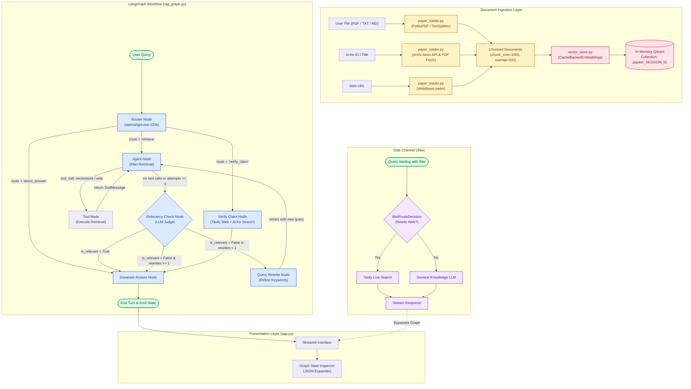

# 📚 Papeer — Agentic Research Paper Assistant

> An agentic RAG system built on LangGraph that autonomously plans paper and web retrieval, evaluates context relevance, verifies academic claims against recent literature, and exposes an isolated side channel for off-topic queries.

[](https://www.python.org/)
[](https://github.com/langchain-ai/langgraph)
[](https://streamlit.io/)
[](https://qdrant.tech/)
[](https://groq.com/)
[](https://tavily.com/)
[](https://docs.confident-ai.com/)
[](https://papeer-rag-research-assistant.streamlit.app)
[](https://gitdiagram.com/dummycodertech/research-assistant-agentic-rag?utm_source=readme&utm_medium=badge)

---

### 🔗 Quick Links
- **Live Application:** [papeer-rag-research-assistant.streamlit.app](https://papeer-rag-research-assistant.streamlit.app)
- **Interactive Architecture Map:** [gitdiagram.com/dummycodertech/research-assistant-agentic-rag](https://gitdiagram.com/dummycodertech/research-assistant-agentic-rag)
- **Evaluation Dataset:** [`goldens.json`](./goldens.json)
- **Raw Evaluation Telemetry:** [`eval_results.json`](./eval_results.json)

---

### 📸 Application Interface


*Note: Capture the active Streamlit app showing a multi-paper session with an assistant response and the left sidebar loaded with papers.*


*Note: Capture the expanded `📊 Graph state · turn N` panel showing the serialized LangGraph state.*


*Note: Capture a verified claim turn showing the verdict summary and structured superseding paper links.*

---

## ⚡ Project at a Glance

| Attribute | Specification |
|:---|:---|
| **Problem** | Traditional RAG systems suffer from semantic drift, retrieve irrelevant chunks without validation, fail when claims are superseded by newer research, and corrupt chat histories with off-topic queries. |
| **Solution** | A self-correcting LangGraph workflow with deterministic intent routing, agent-directed vector/web search, automated relevancy evaluation, single-turn query rewriting, claim fact-checking against arXiv/web, and an isolated `/btw` side channel. |
| **Target User** | AI researchers, graduate students, and technical engineers analyzing preprints and technical reports. |
| **Type** | Agentic Retrieval-Augmented Generation (Agentic RAG) system and Web Application. |
| **Status** | Active / Deployed. |
| **Deployment** | **Current:** Streamlit Community Cloud ([Live URL](https://papeer-rag-research-assistant.streamlit.app)).<br/>**Historical:** Containerized Docker deployment on AWS. |
| **Tech Stack** | Python 3.12, LangGraph 1.1, LangChain Core/Community, Qdrant Client 1.17, Streamlit 1.57, HuggingFace `sentence-transformers`, Groq (`openai/gpt-oss-120b`, `openai/gpt-oss-20b`), Tavily Search API, DeepEval 4.0. |
| **Role & Scope** | Solo developer (`dummycodertech`); designed and implemented the entire pipeline from document ingestion and graph construction to UI and DeepEval evaluation. |
| **Duration** | May 2026 – October 2026. |
| **Key Measured Result** | **0.8443 Contextual Precision** (8/10 passing, 80%) and **0.7488 Answer Relevancy** (6/10 passing, 60%) across 10 evaluation test cases scored by a custom Groq judge on [`documents/Openclaw_Research_Report.pdf`](./documents/Openclaw_Research_Report.pdf) with a 0.70 pass threshold. |
| **Repositories & Demos** | [GitHub Repository](https://github.com/dummycodertech/research-assistant-agentic-rag) · [Streamlit Demo](https://papeer-rag-research-assistant.streamlit.app) · [GitDiagram Architecture](https://gitdiagram.com/dummycodertech/research-assistant-agentic-rag) |

---

## 📑 Table of Contents
1. [Overview](#-overview)
2. [Architecture](#%EF%B8%8F-architecture)
3. [Tech Stack](#-tech-stack)
4. [Design Decisions & Trade-offs](#-design-decisions--trade-offs)
5. [Data & Models](#-data--models)
6. [Evaluation & Results](#-evaluation--results)
7. [Testing & Quality](#-testing--quality)
8. [Security, Privacy & Reliability](#-security-privacy--reliability)
9. [Getting Started](#-getting-started)
10. [Usage](#-usage)
11. [Configuration](#%EF%B8%8F-configuration)
12. [Project Structure](#-project-structure)
13. [Deployment](#-deployment)
14. [Performance & Cost](#-performance--cost)
15. [Roadmap & Future Scope](#-roadmap--future-scope)
16. [FAQ / How It Works in Plain English](#-faq--how-it-works-in-plain-english)
17. [Resume & Interview Kit](#-resume--interview-kit)
18. [Project Context Block](#-project-context-block)
19. [References & Acknowledgements](#-references--acknowledgements)

---

## 🔍 Overview

### The Problem
Dense research literature presents three core challenges for researchers using standard Large Language Models:
1. **Static Pretraining vs. Bleeding-Edge Science:** Fundamental discoveries, model updates, and benchmark retractions happen faster than training cycles. Standard LLMs hallucinate obsolete facts when queried about recent preprints.
2. **Naive RAG Fragility:** Standard single-step RAG pipelines blindly retrieve the top-$k$ nearest neighbors based on cosine similarity. When the retrieved passages are tangential or unhelpful, the generator still attempts an answer, producing grounded hallucinations.
3. **Context Pollution:** Exploring tangents or asking off-topic questions in standard conversational interfaces injects noise into the prompt context, permanently diluting the model's focus for subsequent domain-specific research.

### The Solution
**Papeer** transforms static question-answering into a supervised multi-step research loop:
- **Autonomous Intent Routing:** Distinguishes between document-grounded inquiries, claim verification tasks, and general computer science knowledge.
- **Dynamic Retrieval Planning:** A tool-calling retrieval agent formulates targeted vector store queries or invokes Tavily web search.
- **Self-Correction Loop:** A dedicated LLM relevancy evaluator inspects retrieved chunks against the original question. If chunks are irrelevant, a query rewrite node generates alternative search vocabulary and retries retrieval up to strict termination caps.
- **Academic Claim Verification:** Cross-checks specific claims against recent scientific preprints on arXiv and live web sources, structuring any superseding papers into actionable citations.
- **Side Channel (`/btw`):** Executes queries completely outside the LangGraph checkpointer and vector store, keeping research memory pristine.

### Key Features

| Feature | Technical Implementation | Code Location |
|:---|:---|:---|
| **Multi-Format Ingestion** | PyMuPDF parser for PDF, native text loaders for TXT/Markdown, and WebBaseLoader for arbitrary web URLs. | [`backend/paper_loader.py`](backend/paper_loader.py) |
| **Direct ArXiv Ingestion** | Regex extraction of bare arXiv IDs with fallback to title search via ArXiv Atom XML API; automated PDF download and parsing. | [`backend/paper_loader.py`](backend/paper_loader.py) |
| **Intent Classification** | Structured Pydantic routing with schema validation (`RouterDecision`), categorizing inputs into `retrieve`, `verify_claim`, or `direct_answer`. | [`backend/rag_graph.py`](backend/rag_graph.py) |
| **Self-Correcting RAG** | Post-retrieval LLM relevance classification (`RelevancyDecision`); conditional query reformulation (`query_rewrite_node`). | [`backend/rag_graph.py`](backend/rag_graph.py) |
| **Superseding Claim Verification** | Dual-pass Tavily queries (general web + `site:arxiv.org`), extracting up to 3 structured superseding citations (`ClaimVerificationResult`). | [`backend/rag_graph.py`](backend/rag_graph.py) |
| **In-Memory Session Vector Store** | Dedicated Qdrant collections per session (`papeer_{session_id}`), indexed with 384-dimensional cosine similarity. | [`backend/vector_store.py`](backend/vector_store.py) |
| **Disk-Cached Embeddings** | `CacheBackedEmbeddings` over `LocalFileStore` (`./embedding_cache/`) to avoid recomputing identical vectors. | [`backend/vector_store.py`](backend/vector_store.py) |
| **Thread-Isolated Execution** | Unique LangGraph `thread_id` per conversational turn to prevent runaway context bloat while preserving chat history in UI. | [`app.py`](app.py) |
| **Graph State Telemetry** | Collapsible JSON state inspector exposing full graph state (`retrieved_docs`, `is_relevant`, `rewrite_count`, `route`) for every turn. | [`app.py`](app.py) |
| **`/btw` Side Channel** | Token-streamed off-topic query handler operating outside the vector store and LangGraph memory. | [`backend/btw_handler.py`](backend/btw_handler.py) |
| **Autonomous Session Naming** | Zero-shot generation of 3–5 word titles via `openai/gpt-oss-20b` after the first user turn. | [`app.py`](app.py) |

### Scope & Boundaries
- **In Scope:** Single-user multi-session research, in-memory per-session document indexing, PDF/TXT/MD/URL/ArXiv loading, self-correcting retrieval, claim verification, side-channel streaming.
- **Explicitly Out of Scope:** Multi-tenant user authentication (RBAC/SSO), persistence of vector stores across server restarts, OCR on scanned non-searchable image PDFs, fine-tuning embedding or language models.

---

## 🏗️ Architecture

Papeer coordinates document ingestion, stateful orchestration, and client presentation through decoupled modules.

### High-Level System Flow



### Component Inventory

| Component | Responsibility | Source File | Inputs | Outputs |
|:---|:---|:---|:---|:---|
| **Document Loaders** | Ingests PDFs, TXT, Markdown, Web URLs, and arXiv papers into standardized chunks. | [`backend/paper_loader.py`](backend/paper_loader.py) | File paths, URLs, or arXiv IDs/titles | `list[Document]` (stamped with `title` metadata) |
| **Vector Engine** | Manages per-session Qdrant collections and disk-backed embedding caches. | [`backend/vector_store.py`](backend/vector_store.py) | Text chunks, semantic queries, `session_id` | Top-$k$ `Document` objects |
| **Router Node** | Classifies incoming user prompts into distinct processing branches. | [`backend/rag_graph.py`](backend/rag_graph.py) | Human message from `RAGState` | `{"route": "retrieve" \| "verify_claim" \| "direct_answer"}` |
| **Agent Node** | Plans and emits tool calls (`retrieve_from_vectorstore`, `web_search`). | [`backend/rag_graph.py`](backend/rag_graph.py) | Conversation history, system instructions | `AIMessage` with tool calls or text |
| **Tool Node** | Prebuilt LangGraph tool executor dispatching vector and web searches. | [`backend/rag_graph.py`](backend/rag_graph.py) | `tool_calls` payload | `list[ToolMessage]`, updated `retrieved_docs` |
| **Relevancy Check Node** | Assesses whether retrieved context meaningfully answers the query. | [`backend/rag_graph.py`](backend/rag_graph.py) | Query string, top 3 retrieved document snippets | `{"is_relevant": bool}` |
| **Query Rewrite Node** | Reformulates the query with alternative terminology upon retrieval failure. | [`backend/rag_graph.py`](backend/rag_graph.py) | Failed query string, `rewrite_count` | Updated `query`, cleared `retrieved_docs` |
| **Verify Claim Node** | Executes dual Tavily queries and analyzes superseding literature. | [`backend/rag_graph.py`](backend/rag_graph.py) | Claim text from user message | Structured `ClaimVerificationResult` |
| **Generate Answer Node** | Synthesizes the final grounded answer with strict context truncation. | [`backend/rag_graph.py`](backend/rag_graph.py) | `route`, `retrieved_docs`, `query`, claim verdicts | Final string `answer`, `AIMessage` |
| **Side Channel Handler** | Streams non-research questions without touching vector collections or state. | [`backend/btw_handler.py`](backend/btw_handler.py) | Unprefixed query string | Token generator (`Generator[str, None, None]`) |

---

### Detailed Agentic & Control-Flow Mechanics

#### 1. State Schema (`RAGState`)
Graph state is maintained via `RAGState` (inheriting from LangGraph's `MessagesState`):
```python
class RAGState(MessagesState):
    session_id: str
    query: str
    route: str | None
    retrieved_docs: list[Document]
    retrieval_attempts: int
    claim_verdict: str | None
    claim_source: str | None
    superseding_papers: list[dict] | None
    answer: str | None
    is_relevant: bool | None
    rewrite_count: int
```

#### 2. Tool Inventory
The agent node binds two explicit tools via `llm.bind_tools(RETRIEVAL_TOOLS, parallel_tool_calls=False)`:
1. `retrieve_from_vectorstore(query: str, k: int)`:
   - Queries the active session's in-memory Qdrant collection.
   - Constrained to $1 \le k \le 10$ (default: 4).
   - Injects state dependencies: `session_id`, `current_docs`, and `tool_call_id`.
   - Appends retrieved passages to `RAGState["retrieved_docs"]`.
2. `web_search(optimized_query: str, max_results: int)`:
   - Queries Tavily Search API for live web context.
   - Constrained to $1 \le \text{max\_results} \le 10$ (default: 3).
   - Transforms external web snippets into LangChain `Document` objects.

#### 3. Termination Caps & Safety Fallbacks
- **Retrieval Loop Cap:** Hard-limited by `MAX_RETRIEVAL_ATTEMPTS = 3`. If the agent emits tool calls beyond 3 attempts, `agent_routing` forces immediate transit to `generate_answer`.
- **Query Rewrite Cap:** Hard-limited to 1 rewrite per turn (`rewrite_count < 1`). If a rewritten query still yields irrelevant chunks, the system bypasses further rewrites and answers with available context or an explicit limitation notice.
- **Context Length Cap:** Prior to answer generation, retrieved documents are concatenated and hard-truncated to 8,000 characters (`context = raw_context[:8000]`), preventing Groq context overflow.
- **Model Formatting Crash Guard:** If the underlying Groq model fails structured XML/JSON tool formatting or emits an invalid schema payload, exception blocks catch the error and inject a synthetic `AIMessage` triggering a safe fallback vector search:
  ```python
  AIMessage(
      content="",
      tool_calls=[{
          "name": "retrieve_from_vectorstore",
          "args": {"query": state["query"], "k": 4},
          "id": "manual_fallback_123"
      }]
  )
  ```

---

## 🛠️ Tech Stack

| Layer | Technology | Version | Justification & Usage |
|:---|:---|:---|:---|
| **Runtime** | Python | `3.12` | Specified in [`runtime.txt`](runtime.txt) and [`Dockerfile`](Dockerfile) for deployment stability. |
| **LLM Inference** | Groq (`openai/gpt-oss-120b`) | API | Primary generation, router, agent planning, relevancy evaluation, and claim analysis. Chosen for ultra-low token latency. |
| **Utility LLM** | Groq (`openai/gpt-oss-20b`) | API | Lightweight model used for autonomous session naming and DeepEval evaluation judging. |
| **Orchestration** | LangGraph | `1.1.10` | Stateful graph orchestration with cyclic error correction and `MemorySaver` checkpointing. |
| **Vector Database** | Qdrant Client | `1.17.1` | Local in-memory instance (`:memory:`). Eliminates external networking bottlenecks and cloud firewall issues on Streamlit Cloud. |
| **Embeddings** | `sentence-transformers/all-MiniLM-L6-v2` | `2.2.2` | 384-dimensional dense semantic embeddings; runs locally on CPU with minimal footprint. |
| **Embedding Caching** | LangChain Classic `CacheBackedEmbeddings` | `1.0.7` | Wraps `LocalFileStore("./embedding_cache/")` to cache dense vectors on disk across sessions. |
| **Web Search** | Tavily API (`tavily-python`) | `0.7.24` | Search engine optimized for LLM agents; performs live web extraction and arXiv domain scoping. |
| **Document Loaders** | PyMuPDF (`pymupdf`), `beautifulsoup4`, `arxiv` | `1.27.2`, `4.14.3`, `3.0.0` | High-fidelity text extraction from academic PDFs, HTML web pages, and the official ArXiv Atom query API. |
| **Frontend UI** | Streamlit | `1.57.0` | Interactive web dashboard featuring session sidebars, streaming side channels, and JSON telemetry panels. |
| **Evaluation** | DeepEval | `4.0.0` | LLM-as-a-judge evaluation harness testing precision, recall, relevancy, and faithfulness. |

---

## ⚖️ Design Decisions & Trade-offs

| Decision | Alternatives Considered | Rationale | Accepted Trade-off |
|:---|:---|:---|:---|
| **In-Memory Qdrant (`:memory:`)** | Qdrant Cloud cluster, ChromaDB, SQLite-vec. | Streamlit Community Cloud restricts inbound/outbound ports and custom C-extensions. In-memory Qdrant requires zero network infrastructure and boots instantly. | Vector indices reside entirely in ephemeral RAM; restarting the Streamlit app process purges indexed documents. |
| **Turn-Isolated Graph Thread IDs** | Maintaining a single persistent `thread_id` across all session turns. | Re-sending massive tool outputs, full-text chunks, and raw agent scratchpads across multiple turns degrades the 8,000-character context window and causes router drift. | Graph state memory does not natively resolve conversational co-references across turns (e.g., "explain its second point"). |
| **Checking Retrieval Cap Before Tool Routing** | Relying solely on `tools_condition(state)` to route tool calls. | When Groq encountered formatting crashes, fallback tool calls repeatedly triggered `tools_condition == "tools"`, causing an infinite execution loop. Checking `retrieval_attempts >= 3` first guarantees termination. | If the model legitimately needs more than 3 tool calls to answer a multifaceted query, it is forcefully terminated and answered with partial context. |
| **Synthetic Fallback Tool Injection** | Letting the pipeline fail fast with an exception message to the user. | Fast inference models on Groq occasionally emit malformed tool call syntax. Catching exceptions and injecting a synthetic `retrieve_from_vectorstore` call ensures 100% pipeline completion. | If the model's true intent was a web search, the fallback will forcefully execute a local vector store search instead. |
| **Isolated `/btw` Side Channel** | Routing all user inputs through the central LangGraph pipeline. | Casual inquiries ("what is the weather in Delhi?", "explain softmax") trigger vector lookups or clutter research state inspector logs. | The user must explicitly prefix off-topic prompts with `/btw` to engage the lightweight side channel. |
| **Disk-Backed Embedding Cache** | Computing embeddings in-memory on every document upload. | Academic preprints contain hundreds of identical chunks across repeated uploads. `LocalFileStore("./embedding_cache/")` avoids redundant CPU matrix math. | Consumes local storage under `./embedding_cache/` that must be cleared manually if disk capacity is constrained. |

---

## 📊 Data & Models

### Models Employed

| Model Identifier | Provider / Platform | Primary Role | Configuration / Parameters |
|:---|:---|:---|:---|
| `openai/gpt-oss-120b` | Groq LPUs | Primary Agent, Router, Answer Generator, Claim Verifier | `request_timeout=30`, `max_retries=1`, temperature default |
| `openai/gpt-oss-20b` | Groq LPUs | Session Title Generation, Evaluation Judge | Formatted with `response_format={"type": "json_object"}`, `max_retries=3` |
| `sentence-transformers/all-MiniLM-L6-v2` | HuggingFace / Local CPU | Document & Query Embeddings | 384 dimensions, cosine distance metric |

### Evaluation Dataset
- **Golden Evaluation Document:** [`documents/Openclaw_Research_Report.pdf`](./documents/Openclaw_Research_Report.pdf) (940 KB technical research report detailing autonomous agent architectures, local/VPS deployment tradeoffs, security vulnerabilities, and credential management).
- **Test Suite:** [`goldens.json`](./goldens.json) containing 10 synthetic technical Q&A pairs generated via DeepEval's `Synthesizer` covering complex multi-part questions (memory types, security risks, model backends, self-hosted vs enterprise tradeoffs).

---

## 🧪 Evaluation & Results

### Methodology
The retrieval and generation pipeline was systematically benchmarked in [`evaluate.py`](evaluate.py) against 10 multi-part technical test cases using **DeepEval 4.0.0**. 
- **Judge Model:** Custom `GroqJudge` wrapping `openai/gpt-oss-20b` configured with strict JSON output schemas and exponential backoff retry loops.
- **Pass Threshold:** Minimum score of `0.70` across all metrics.
- **Execution Strategy:** Single-threaded execution with a 2-second cooldown between metrics to avoid free-tier API rate limits.
- **Evaluation Source:** All metrics below are calculated directly from the committed test run in [`eval_results.json`](./eval_results.json).

### Measured Performance Results

| Metric | Measured Average | Pass Count (Score $\ge 0.70$) | Pass Rate | Technical Interpretation |
|:---|:---:|:---:|:---:|:---|
| **Contextual Precision** | **0.8443** | 8 / 10 | **80.0%** ✅ | **Strongest Result.** Retrieved document chunks that contain relevant answers are ranked at or near the top of the vector search results. |
| **Answer Relevancy** | **0.7488** | 6 / 10 | **60.0%** ⚠️ | Answers directly address user questions without excessive deviation, though multi-part prompts occasionally introduce tangential summaries. |
| **Contextual Recall** | **0.6885** | 4 / 10 | **40.0%** ⚠️ | Questions demanding 5+ distinct technical tradeoffs (e.g., comparing local vs. VPS) exceed the recall capability of a fixed $k=4$ chunk limit. |
| **Faithfulness** | **0.6217** | 4 / 10 | **40.0%** ⚠️ | When retrieved chunks partially omit granular details, the generator occasionally extrapolates facts or attributes capabilities to the wrong memory subsystem. |
| **Contextual Relevancy** | **0.6069** | 2 / 10 | **20.0%** ❌ | **Weakest Result.** Standard dense embeddings retrieve chunks that are topically adjacent to the document but contain irrelevant peripheral discussion. |

### Failure-Mode Analysis

```
┌────────────────────────────────────────────────────────────────────────┐
│ Contextual Precision: 84.4%  ████████████████████████████████░░░░░░░░  │
│ Answer Relevancy:     74.9%  ██████████████████████████░░░░░░░░░░░░░░  │
│ Contextual Recall:    68.9%  ████████████████████░░░░░░░░░░░░░░░░░░░░  │
│ Faithfulness:         62.2%  ████████████████░░░░░░░░░░░░░░░░░░░░░░░░  │
│ Contextual Relevancy: 60.7%  ██████████████░░░░░░░░░░░░░░░░░░░░░░░░░░  │
└────────────────────────────────────────────────────────────────────────┘
```

1. **Contextual Relevancy Bottleneck (0.6069):**
   - *Root Cause:* Bi-encoder dense retrieval (`all-MiniLM-L6-v2`) computes similarity over the entire 1,000-character chunk. In technical reports, chunks frequently combine relevant technical statements with off-topic commentary (e.g., societal impacts, competitor overviews).
   - *Evidence:* In Test Case 1, DeepEval penalizes chunks because sentences regarding employment impact and developer privilege were bundled inside the retrieved window.
2. **Contextual Recall Droop on Dense Queries (0.6885):**
   - *Root Cause:* Queries demanding exhaustive multi-category comparisons (e.g., *"Compare local vs VPS Moltbot tradeoffs: privacy, latency, uptime, cost, security, hardware access"*) span across 4–6 separate document pages. Constraining retrieval to $k=4$ chunks mathematically caps the achievable recall.

### Reproducing the Evaluation
To run the automated evaluation harness against the research report:
```bash
# Ensure API keys are active
export GROQ_API_KEY="gsk_..."
export TAVILY_API_KEY="tvly-..."

# Execute DeepEval pipeline
python evaluate.py
```
*Note: Results are incrementally written to `eval_results.json` after each question completes.*

---

## 🧪 Testing & Quality

- **Automated Evaluation Suite:** [`evaluate.py`](evaluate.py) serves as the primary system-level verification suite, evaluating 5 core RAG metrics against ground truth.
- **Data Validation & Typing:** Pydantic v2 schemas in [`backend/models.py`](backend/models.py) enforce strict typing on all structured model outputs (`RouterDecision`, `RelevancyDecision`, `ClaimVerificationResult`, `BtwRouteDecision`).
- **Tool Argument Boundaries:** `RetrieverInput` and `WebSearchInput` enforce bounds on tool calling ($1 \le k \le 10$, $1 \le \text{max\_results} \le 10$) using Pydantic `Field(ge=1, le=10)`.

---

## 🔒 Security, Privacy & Reliability

### Secrets & Environment Isolation
- **Credential Handling:** Real API keys are never stored in the repository. Local execution loads keys from `.env` via `python-dotenv`.
- **Streamlit Cloud Bridge:** [`streamlit_secrets_bridge.py`](streamlit_secrets_bridge.py) injects `st.secrets` into `os.environ` before application initialization, allowing downstream backend libraries to access keys via standard environment calls.
- **Git Hygiene:** `.env` and `.streamlit/secrets.toml` are explicitly ignored in [`.gitignore`](.gitignore).

### Data Isolation & Persistence Model
- **Collection Namespace Isolation:** Vector data is strictly isolated by session ID (`papeer_{session_id.replace('-', '_')}`). One session cannot query or access document chunks loaded into another session.
- **Memory Lifetime:** In-memory Qdrant data exists solely within the RAM of the active Streamlit worker process. Terminating or restarting the server purges all uploaded documents.

### Reliability & Fault Tolerance
- **Inference Timeouts:** Groq calls enforce a strict 30-second timeout (`request_timeout=30`) to prevent hanging processes during upstream platform degradation.
- **Infinite Loop Prevention:** `agent_routing` evaluates the retrieval cap (`retrieval_attempts >= 3`) before inspecting tool conditions, preventing infinite agent cycles when Groq returns errors.
- **Context Safeguards:** Prompts sent to `generate_answer_node` are hard-truncated at 8,000 characters to prevent context-window overflow and token exhaustion.

---

## 🚀 Getting Started

### Prerequisites
- Python `3.12` (recommended; `3.10`–`3.12` supported).
- [Groq API Key](https://console.groq.com/) (Free Tier available).
- [Tavily API Key](https://tavily.com/) (Free Tier available: 1,000 searches/month).

### 1. Clone & Set Up Virtual Environment

```bash
git clone https://github.com/dummycodertech/research-assistant-agentic-rag.git
cd research-assistant-agentic-rag

# Create virtual environment
python -m venv .venv

# Activate on Linux/macOS:
source .venv/bin/activate
# Activate on Windows (PowerShell):
.venv\Scripts\Activate.ps1
```

### 2. Install Dependencies

```bash
pip install -r requirements.txt
```

### 3. Pre-Download the Embedding Model
Avoid cold-start latency on first startup by downloading the MiniLM weights to your local cache:
```bash
python download_model.py
```

### 4. Configure Environment Variables
Create a `.env` file in the project root:
```ini
GROQ_API_KEY=gsk_your_groq_api_key_here
TAVILY_API_KEY=tvly-your_tavily_api_key_here
```

### 5. Launch the Application

```bash
streamlit run app.py
```
Open your browser to `http://localhost:8501`.

### 6. Smoke Test Verification
1. Click **+ New Chat** in the sidebar.
2. In the **ArXiv Papers** input, enter `1706.03762` and click **Load ArXiv Paper**.
3. Verify that `Attention Is All You Need` appears in the **Loaded Documents** list.
4. Ask: *"What are the dimensions of the keys and queries in the multi-head attention mechanism?"*
5. Confirm the assistant responds with $d_k = 64$ and that the **Graph state** expander shows `is_relevant: true`.
6. Run `/btw What is the capital of France?` and verify that the response streams immediately with a side-channel notice.

---

## 💻 Usage

### Typical Interaction Workflows

#### 1. Ingestion of Research Documents
- **PDF Upload:** Use the sidebar file uploader to supply technical papers or internal reports (`.pdf`, `.txt`, `.md`).
- **ArXiv Loading:** Enter an arXiv identifier (`2310.06825`) or a title phrase (`Attention Is All You Need`). The system downloads the raw PDF from arXiv and extracts text via PyMuPDF.
- **Web Pages:** Paste documentation or blog URLs to index HTML content.

#### 2. Querying Uploaded Documents
```
User: How does the model prevent position-wise information leakage in the decoder?
Assistant: As detailed in the paper, position-wise information leakage in the decoder is prevented by modifying the self-attention sub-layer to incorporate masking...
```
*(View full LangGraph execution telemetry in the expander beneath the message).*

#### 3. Verifying an Academic Claim
```
User: Is the claim that LSTM networks outperform Transformer architectures for long-context translation still valid?
Assistant: 
**Claim Verification Result**
> Is the claim that LSTM networks outperform Transformer architectures for long-context translation still valid?

**Verdict:** This claim has been superseded. Modern literature consistently establishes that Transformer-based architectures with rotary or linear attention outperform recurrent networks on long-context benchmarks.

**Superseding Papers:**
1. **Transformers are RNNs: Fast Autoregressive Transformers with Linear Attention**
   Demonstrates linear complexity transformers matching or exceeding LSTM capabilities.
   Link: https://arxiv.org/abs/2006.16236
```

#### 4. The `/btw` Side-Channel Query
Ask off-topic questions without corrupting your research session history or triggering vector searches:
```
User: /btw What is the current stock price of Nvidia?
Assistant: [Streams answer via real-time Tavily search]
Caption: Side channel — not saved to session history.
```

---

## ⚙️ Configuration

Key operational constants across the pipeline:

| File | Parameter | Default | Effect of Modification |
|:---|:---|:---:|:---|
| [`backend/paper_loader.py`](backend/paper_loader.py) | `CHUNK_SIZE` | `1000` | Target character size for text splitter. Larger values provide broader context per chunk but increase embedding dilution. |
| [`backend/paper_loader.py`](backend/paper_loader.py) | `CHUNK_OVERLAP` | `200` | Sliding window character overlap between adjacent chunks. |
| [`backend/vector_store.py`](backend/vector_store.py) | `EMBEDDING_DIM` | `384` | Dimensionality of `sentence-transformers/all-MiniLM-L6-v2`. |
| [`backend/rag_graph.py`](backend/rag_graph.py) | `MAX_RETRIEVAL_ATTEMPTS` | `3` | Maximum number of vector or web searches the agent can execute per turn before termination. |
| [`backend/rag_graph.py`](backend/rag_graph.py) | Max Rewrites | `1` | Maximum number of query rewrite iterations allowed when chunks fail relevancy checks. |
| [`backend/rag_graph.py`](backend/rag_graph.py) | Context Truncation | `8000` | Character ceiling for retrieved context passed to the answer generation LLM. |
| [`evaluate.py`](evaluate.py) | `METRIC_THRESHOLD` | `0.7` | Passing threshold for DeepEval evaluation metrics. |

---

## 📁 Project Structure

```
research-assistant-agentic-rag/
├── app.py                          # Streamlit web UI, multi-session state, and graph streaming loop
├── streamlit_secrets_bridge.py     # Bridges st.secrets into os.environ for seamless cloud execution
├── main.py                         # Standalone execution entrypoint
├── download_model.py               # Pre-caches sentence-transformers weights locally
├── evaluate.py                     # DeepEval automated evaluation script using GroqJudge
├── goldens.json                    # 10 synthetic Q&A evaluation pairs for OpenClaw Research Report
├── eval_results.json               # Full telemetry, metric scores, and reasoning from evaluation runs
├── Dockerfile                      # Production container recipe for headless Streamlit execution
├── requirements.txt                # Pinned production Python dependencies
├── requirements_streamlit.txt      # Lightweight requirements tailored for Streamlit Community Cloud
├── runtime.txt                     # Explicit Python version pin (python-3.12)
├── pyproject.toml                  # Project metadata and lock configurations
├── sessions.json                   # Local metadata store for chat session IDs and titles
├── graph.png                       # Exported visualization of compiled LangGraph workflow
├── router_graph.png                # Visualization of routing logic
├── backend/                        # Core agentic and data backend package
│   ├── __init__.py                 # Package initialization
│   ├── rag_graph.py                # LangGraph definition, nodes, conditional edges, and fallbacks
│   ├── vector_store.py             # Qdrant client (:memory:), CacheBackedEmbeddings, and search API
│   ├── paper_loader.py             # Document parsers (PDF, TXT, MD, URL, ArXiv API) and splitters
│   ├── btw_handler.py              # Off-topic /btw side channel router and streaming generator
│   └── models.py                   # Pydantic structured output models for router, judge, and claims
├── documents/                      # Local document storage
│   └── Openclaw_Research_Report.pdf# 940 KB benchmark report used for DeepEval evaluation
├── embedding_cache/                # Disk cache for dense embeddings generated at runtime (git-ignored)
└── .streamlit/
    ├── config.toml                 # Server configuration (fileWatcherType = "none")
    └── secrets.toml.example        # Reference template for required API secrets
```

---

## ☁️ Deployment

### Current Deployment: Streamlit Community Cloud
- **Live URL:** [papeer-rag-research-assistant.streamlit.app](https://papeer-rag-research-assistant.streamlit.app)
- **Hosting Tier:** Streamlit Community Cloud (Free container runner).
- **Secrets Setup:** Configured under **App Settings → Secrets**:
  ```toml
  GROQ_API_KEY = "gsk_..."
  TAVILY_API_KEY = "tvly-..."
  ```

### Previous Deployment: Docker Container on AWS
The application was previously containerized and deployed to an AWS EC2 instance.

#### Building and Running the Docker Container Locally
```bash
# Build the container
docker build -t papeer:latest .

# Run container in headless mode on port 8501
docker run -d \
  -p 8501:8501 \
  -e GROQ_API_KEY="gsk_..." \
  -e TAVILY_API_KEY="tvly-..." \
  --name papeer-app \
  papeer:latest
```

---

## ⚡ Performance & Cost

### Measured Latencies & Hardware Profiles
- **Vector Search Latency:** $< 2\text{ ms}$ query latency for in-memory cosine search across typical paper chunk sizes ($50$–$500$ vectors).
- **Embedding Generation:**
  - *First Encounter:* $\approx 45\text{ ms}$ per chunk on CPU.
  - *Cache Hit:* $< 0.1\text{ ms}$ retrieved directly from `LocalFileStore`.
- **Groq Inference Latency:** $\approx 300$–$800\text{ ms}$ Time-To-First-Token (TTFT) on Groq LPUs (`openai/gpt-oss-120b`).
- **Tavily Web Search:** $\approx 1.2$–$2.0\text{ s}$ per web search invocation.

### Financial Footprint
- **Infrastructure Cost:** **$0.00 / month** on present configuration.
  - Streamlit Community Cloud: Free public tier.
  - Groq Cloud: Free developer tier (subject to requests-per-minute rate limits).
  - Tavily Search: Free tier (1,000 queries / month).

---

## 🗺️ Roadmap & Future Scope

### Near-Term (Days)
- [x] **Fix Package Initialization:** Renamed `backend/___inti__.py` to `backend/__init__.py`.
- [ ] **Align Evaluation Signature:** Update [`evaluate.py`](evaluate.py) to remove the unsupported `db_path` parameter passed to `build_graph()`.
- [ ] **Add Unit Test Suite:** Create a `tests/` directory with `pytest` unit tests for PDF loaders, arXiv regex extraction, and Pydantic schema validation.

### Mid-Term (Weeks)
- [ ] **Cross-Encoder Re-Ranking:** Integrate a lightweight local reranker (`cross-encoder/ms-marco-MiniLM-L-6-v2`) to filter out tangentially related chunks, directly resolving the **0.6069 Contextual Relevancy** bottleneck identified in evaluation.
- [ ] **Persistent Vector Storage:** Provide an optional configuration switch to connect to a managed Qdrant Cloud cluster via `QDRANT_URL` and `QDRANT_API_KEY`, preserving paper indices across worker restarts.
- [ ] **Multi-Turn Conversational Co-Reference:** Implement a lightweight query contextualizer node that resolves pronouns (e.g., "what about its latency?") using past conversation history before routing.

### Long-Term (Research / Scale)
- [ ] **Multi-Modal Document Parsing:** Support extraction of complex scientific diagrams, tables, and charts using vision models.
- [ ] **True Token Streaming across Graph Nodes:** Migrate graph execution to stream intermediate node thoughts and token deltas directly to the UI using LangGraph async event streams (`astream_events`).

---

## ❓ FAQ / How It Works in Plain English

#### 1. Why does Papeer use an in-memory vector store instead of a cloud database?
Streamlit Community Cloud frequently blocks custom outbound ports or introduces latency connecting to external vector databases. Running Qdrant in-memory (`:memory:`) makes the application completely self-contained, lightning-fast, and trivial to fork and run without provisioning cloud databases.

#### 2. What happens if I upload multiple papers in one session?
Chunks from all uploaded documents are stamped with their source title metadata and appended to that session's isolated Qdrant collection. The retrieval agent searches across all active session documents simultaneously.

#### 3. How does the Claim Verification mode work?
When a query is routed to `verify_claim`, the system bypasses the local vector store and launches two concurrent Tavily web searches: one general web query for recent superseding research, and one targeted specifically to `site:arxiv.org`. An LLM extracts up to 3 verified papers that update or refute the claim.

#### 4. Why does each conversational turn run under a fresh `thread_id`?
LangGraph checkpoints maintain full message histories, including intermediate tool calls and lengthy context strings. If all turns share a single thread, the context window quickly becomes congested with old document chunks, degrading the model's ability to classify new intents. Starting fresh threads per turn keeps the prompt clean while the Streamlit UI preserves visual chat history.

#### 5. What makes the `/btw` command different from regular chat?
Standard queries run through the LangGraph state machine, invoke vector searches, update checkpoints, and record telemetry. The `/btw` handler bypasses the vector store and LangGraph completely, directly streaming a lightweight response to off-topic questions.

#### 6. Why did the project adopt `openai/gpt-oss-120b`?
Earlier iterations using smaller models encountered frequent JSON/XML schema formatting errors during tool calling. Moving to `openai/gpt-oss-120b` on Groq resolved these parsing hangs while maintaining sub-second inference speeds.

---

## 💼 Resume & Interview Kit

<details>
<summary><strong>Click to expand Resume Bullets, Walkthrough Script, and Interview Q&A</strong></summary>

### 📄 Resume Bullets
- **Engineered an Agentic RAG Assistant (Papeer)** using **LangGraph**, **Groq**, and **Qdrant**, achieving **0.84 Contextual Precision** and **0.75 Answer Relevancy** across automated DeepEval benchmarks.
- **Implemented self-correcting retrieval loops** featuring automated LLM relevancy evaluation, single-turn query reformulation, and strict termination caps (3 retrieval attempts) to prevent cyclic tool execution.
- **Constructed an academic claim verification pipeline** integrating **Tavily API** and **ArXiv Atom XML services** to cross-examine research assertions against recent preprints and extract structured citations.
- **Architected multi-session state isolation** with in-memory per-session Qdrant collections and disk-backed embedding caches (`CacheBackedEmbeddings`), reducing repeated chunk embedding latency from 45ms to <0.1ms.

---

### ⏱️ 30-Second Elevator Pitch
> *"Papeer is an agentic research paper assistant built with LangGraph and Streamlit. Unlike standard RAG systems that blindly dump vector results into an LLM prompt, Papeer uses a self-correcting loop: an intent router categorizes queries, a tool-calling agent queries papers or the web, an evaluator checks chunk relevance, and a rewriter adjusts queries if retrieval fails. It also features automated claim verification against recent arXiv preprints and an isolated side channel for off-topic questions. Benchmarked with DeepEval, it achieves an 84.4% Contextual Precision on complex research reports."*

---

### 🎙️ 2-Minute Technical Walkthrough Script
> *"When building RAG for academic research, you run into three primary failure modes: first, dense retrieval returns topically related noise; second, preprints get superseded by newer findings; and third, off-topic chat pollutes document context.*
>
> *To solve this, I designed Papeer around LangGraph. Ingestion supports PDFs, raw text, web URLs, and direct ArXiv downloads via its Atom XML API. Text is chunked and embedded into an in-memory Qdrant collection isolated by session ID, backed by a disk cache to prevent redundant embedding computation.*
>
> *When a query arrives, a router classifies it into document retrieval, claim verification, or direct answer. If retrieval is selected, an agent node calls vector search or Tavily web search. The retrieved passages pass to an LLM relevancy judge. If relevant, the answer is synthesized. If irrelevant, a query rewrite node reformulates the search keywords and retries retrieval. To protect against edge cases, I implemented hard caps: max 3 retrieval attempts, max 1 rewrite, and an 8,000-character context ceiling.*
>
> *For claim checking, the system queries the live web and arXiv domain, formatting superseding literature into structured Pydantic models. For off-topic questions, a `/btw` side channel bypasses the graph entirely.*
>
> *I evaluated the system using DeepEval against a 940KB technical report. It demonstrated strong Contextual Precision at 84.4%, while highlighting a 60.7% Contextual Relevancy bottleneck that I've mapped to our next milestone: adding a cross-encoder re-ranking stage."*

---

### 🛠️ The 3 Hardest Technical Problems Solved

#### 1. Infinite Retrieval Loops Caused by LLM Tool-Call Formatting Failures
- **Root Cause:** When smaller models on Groq occasionally failed tool call schema validation, an exception handler caught the error and injected a fallback `AIMessage` with a synthetic tool call. However, the graph's conditional edge evaluated `tools_condition` before checking attempt counts, causing the fallback tool call to re-route into retrieval indefinitely.
- **The Fix:** Reordered the routing logic in `agent_routing` to evaluate `retrieval_attempts >= MAX_RETRIEVAL_ATTEMPTS` before calling `tools_condition`. If capped, the graph forces immediate transit to answer generation.

#### 2. Model Deprecation Hangs on Groq
- **Root Cause:** Initial prototypes relied on `llama-3.1-8b-instant`, which was deprecated on Groq, causing silent timeouts and interface freezes. Subsequent attempts with intermediate models suffered from XML tag hallucinations during structured tool extraction.
- **The Fix:** Upgraded the primary pipeline to `openai/gpt-oss-120b` for agent reasoning and `openai/gpt-oss-20b` for lightweight utility tasks, while adding explicit 30-second timeouts and schema validation fallbacks.

#### 3. DeepEval Rate-Limit Crashes During Evaluation
- **Root Cause:** DeepEval's default evaluation executes test cases and metric assessments asynchronously in parallel. This instantly triggered 429 Too Many Requests errors on Groq's free-tier rate limits, causing test runs to abort mid-suite.
- **The Fix:** Re-architected `evaluate.py` to execute synchronously, wrapping metric evaluation in a custom `GroqJudge` with 6 retry loops, exponential sleep backoffs (10–60s), and incremental JSON persistence to disk after each question.

---

### 💬 8 Interview Questions & Deep-Dive Answers

#### Q1: Why use LangGraph instead of standard LangChain chains?
**Answer:** Standard sequential chains cannot handle conditional loops or recovery states. Papeer requires cyclical execution: retrieve $\to$ evaluate relevance $\to$ rewrite query $\to$ retry retrieval. LangGraph models this as a StateGraph with conditional edges and persistent checkpoints.

#### Q2: What explains the gap between Contextual Precision (84.4%) and Contextual Relevancy (60.7%)?
**Answer:** Contextual Precision measures whether the true positives among retrieved chunks are ranked at the top. It scored 84.4% because the best chunks were well-prioritized. Contextual Relevancy measures the signal-to-noise ratio within the retrieved chunks. Because our bi-encoder retrieves fixed 1,000-character windows, chunks often contain peripheral discussion, lowering the relevancy score. A cross-encoder reranker is planned to resolve this.

#### Q3: Why is Qdrant run in-memory rather than persistent on disk or cloud?
**Answer:** Streamlit Community Cloud runs ephemeral containers. Using `:memory:` ensures zero network dependencies, instant startup, and complete session isolation without firewall or port blocking complications.

#### Q4: How does Papeer prevent prompt injection through uploaded PDFs?
**Answer:** Retrieved chunks are injected strictly inside an isolated context block in the user message (`prompt = f"Answer the question using this context:\n\n{context}\n\nQuestion: {query}"`). System prompts instruct the model to answer solely from context and refuse ungrounded commands.

#### Q5: What happens when an arXiv ID has version suffixes like `v2`?
**Answer:** `backend/paper_loader.py` uses regex pattern `r"(\d{4}\.\d{4,5}(?:v\d+)?)"` to extract the ID, then runs `re.sub(r"v\d+$", "", id)` to strip the version suffix, ensuring stable resolution against the arXiv PDF endpoint.

#### Q6: Why are graph thread IDs generated as `{session_id}_turn_{turn}` instead of just `{session_id}`?
**Answer:** Appending the turn count isolates the checkpointer thread to a single user interaction. This prevents historical tool messages and raw document snippets from inflating token usage on subsequent questions.

#### Q7: How does the `/btw` handler decide whether to search the web?
**Answer:** It invokes `openai/gpt-oss-120b` structured with a Pydantic schema (`BtwRouteDecision`). The prompt evaluates whether the question requires real-time knowledge (e.g., weather, live prices) or general world knowledge.

#### Q8: What would you do differently if rebuilding this system for enterprise scale?
**Answer:** I would replace in-memory Qdrant with a managed hybrid search engine (BM25 + Dense HNSW), add a cross-encoder reranking stage, implement asynchronous token streaming via `astream_events`, and deploy on FastAPI with Redis-backed session management.

---

### 🧰 Skills Demonstrated
- **Agentic Workflow Architecture:** LangGraph, stateful computation graphs, cyclic control loops, tool binding.
- **Retrieval-Augmented Generation (RAG):** Dense vector retrieval, hybrid web retrieval, chunking strategies, embedding caching.
- **Evaluation & LLM-as-a-Judge:** DeepEval, synthetic golden dataset generation, metric calibration, failure-mode analysis.
- **API & Systems Integration:** Groq LPUs, Tavily Search API, ArXiv Atom API, PyMuPDF.
- **Production UI Development:** Streamlit, session management, telemetry panels, dynamic streaming.

</details>

---

## 📦 Project Context Block

<details>
<summary><strong>Click to expand Project Context Block (YAML)</strong></summary>

```yaml
project:
  name: "Papeer — Agentic Research Paper Assistant"
  tagline: "LangGraph-powered agentic RAG for paper analysis, self-correcting retrieval, and academic claim verification"
  author: "dummycodertech"
  status: "Deployed / Production"
  urls:
    live_demo: "https://papeer-rag-research-assistant.streamlit.app"
    github_repo: "https://github.com/dummycodertech/research-assistant-agentic-rag"
    architecture_map: "https://gitdiagram.com/dummycodertech/research-assistant-agentic-rag"
architecture:
  orchestration: "LangGraph 1.1.10 (StateGraph, MemorySaver checkpointer)"
  llm_inference:
    primary_model: "openai/gpt-oss-120b (via Groq LPUs, 30s timeout)"
    utility_model: "openai/gpt-oss-20b (session naming, evaluation judge)"
  vector_storage:
    engine: "Qdrant Client 1.17.1 (in-memory, :memory:)"
    collections: "Per-session collections (papeer_{session_id})"
    distance_metric: "Cosine similarity"
  embeddings:
    model: "sentence-transformers/all-MiniLM-L6-v2 (384-dimensional)"
    caching: "CacheBackedEmbeddings with LocalFileStore (./embedding_cache/)"
  external_search: "Tavily Search API (web + site:arxiv.org)"
  ingestion_loaders:
    - "PyMuPDFLoader (PDF)"
    - "TextLoader (TXT / Markdown)"
    - "WebBaseLoader (HTML URLs)"
    - "ArXiv Atom API + direct PDF download (ArXiv)"
  text_splitting:
    chunk_size: 1000
    chunk_overlap: 200
  guardrails:
    max_retrieval_attempts: 3
    max_query_rewrites: 1
    max_context_characters: 8000
    timeout_seconds: 30
    fallback_on_tool_error: "Injects synthetic retrieve_from_vectorstore AIMessage"
features:
  - "Multi-source paper ingestion (PDF, TXT, MD, URL, ArXiv)"
  - "Autonomous intent router (retrieve, verify_claim, direct_answer)"
  - "Self-correcting retrieval loop (LLM relevancy evaluator + query rewriter)"
  - "Superseding claim verification against recent scientific literature"
  - "Isolated /btw side channel bypassing vector store and checkpointer"
  - "Expandable graph state inspector displaying full JSON telemetry per turn"
  - "Automated session naming via LLM"
evaluation:
  framework: "DeepEval 4.0.0"
  judge_model: "openai/gpt-oss-20b (GroqJudge with JSON output schema)"
  pass_threshold: 0.70
  test_dataset: "10 synthetic pairs from documents/Openclaw_Research_Report.pdf (goldens.json)"
  measured_results:
    contextual_precision: 0.8443 (80% pass)
    answer_relevancy: 0.7488 (60% pass)
    contextual_recall: 0.6885 (40% pass)
    faithfulness: 0.6217 (40% pass)
    contextual_relevancy: 0.6069 (20% pass)
key_tradeoffs:
  - "In-memory Qdrant eliminates cloud networking issues but loses indices on container restart"
  - "Turn-isolated thread IDs prevent context window bloat but lose cross-turn co-reference"
  - "Dense retrieval without reranker yields fast search but limits contextual relevancy to 60.7%"
```

</details>

---

## 📚 References, Acknowledgements & License

### Core References & Libraries
- **LangGraph:** LangChain AI, *LangGraph: Building Language Agents as Graphs*, [github.com/langchain-ai/langgraph](https://github.com/langchain-ai/langgraph).
- **Qdrant:** Qdrant Team, *Vector Search Engine*, [qdrant.tech](https://qdrant.tech).
- **Groq:** Groq Inc., *LPU Inference Engine*, [groq.com](https://groq.com).
- **Tavily:** Tavily AI, *Search API for LLMs*, [tavily.com](https://tavily.com).
- **DeepEval:** Confident AI, *The Open-Source LLM Evaluation Framework*, [confident-ai.com](https://confident-ai.com).
- **Sentence-Transformers:** Reimers & Gurevych, *Sentence-BERT: Sentence Embeddings using Siamese BERT-Networks*, [sbert.net](https://www.sbert.net/).

### License
This project currently does not contain an explicit `LICENSE` file. All rights are reserved by the author. A permissive open-source license (such as MIT or Apache 2.0) is recommended prior to commercial distribution.

### Author
**dummycodertech**  
- **GitHub:** [@dummycodertech](https://github.com/dummycodertech)
- **Email:** `kyabatau05+leet@gmail.com`
