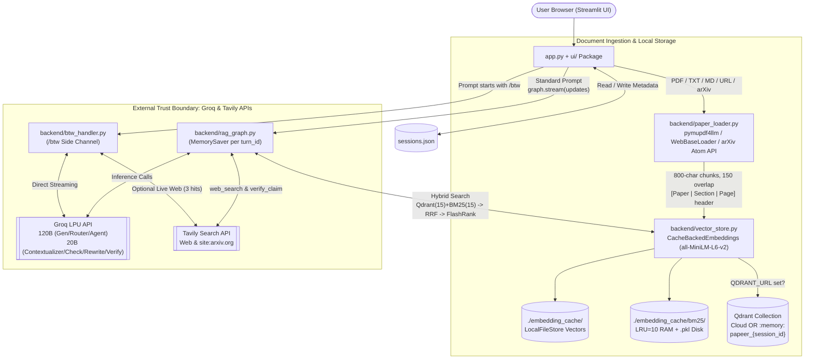
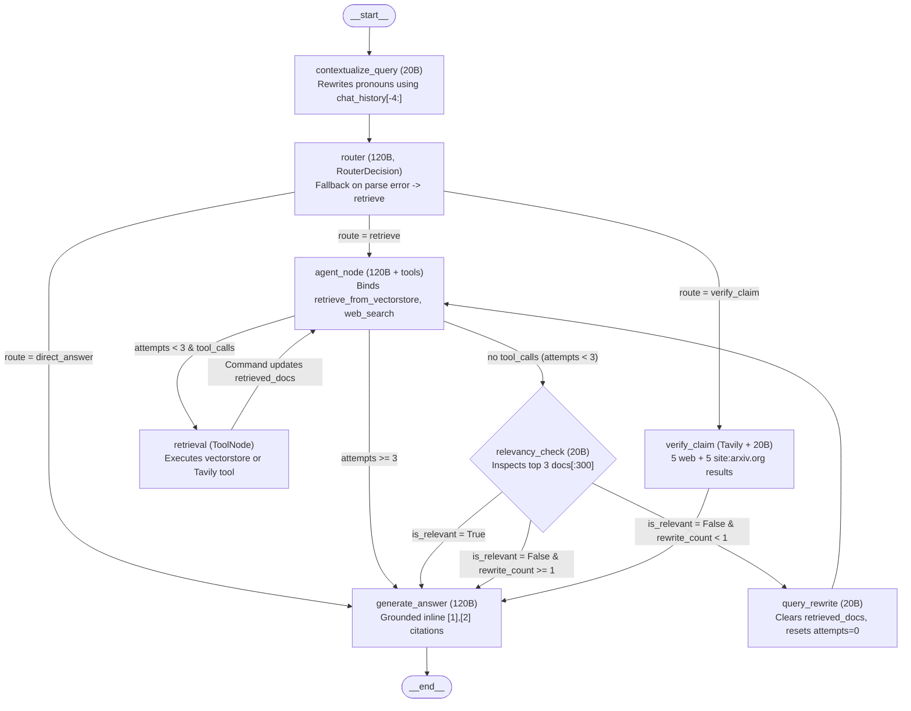
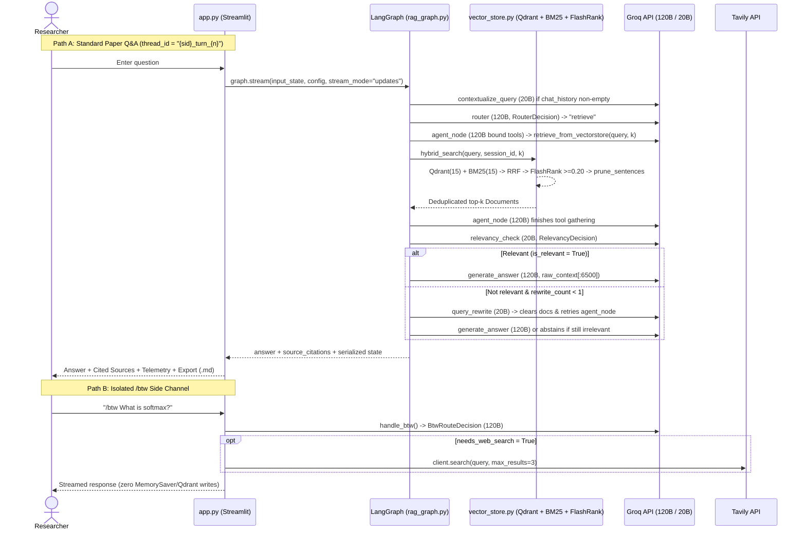

# Papeer — Agentic Research Paper Assistant

> A self-correcting LangGraph agentic RAG application for academic paper Q&A, hybrid dense-plus-lexical retrieval with FlashRank reranking, live literature claim verification, and an isolated `/btw` side channel.

[%20%7C%203.14_(pyproject)-3776AB?logo=python&logoColor=white)](runtime.txt)
[](pyproject.toml)
[](requirements.txt)
[](pyproject.toml)
[](pyproject.toml)
[](requirements.txt)
[](backend/rag_graph.py)
[](pyproject.toml)
[](pyproject.toml)
[](https://papeer-rag-research-assistant.streamlit.app)

> **Note:** No `LICENSE` file or `.github/workflows/` CI configuration currently exists in the repository, so dynamic license, build, and coverage badges are omitted.

### Quick Links

- **Live Demo:** [papeer-rag-research-assistant.streamlit.app](https://papeer-rag-research-assistant.streamlit.app)
- **Interactive Architecture Map:** [gitdiagram.com/dummycodertech/research-assistant-agentic-rag](https://gitdiagram.com/dummycodertech/research-assistant-agentic-rag)
- **Evaluation Benchmark Set:** [`goldens.json`](goldens.json) · [`documents/Openclaw_Research_Report.pdf`](documents/Openclaw_Research_Report.pdf)
- **Measured Evaluation Results:** [`eval_results.json`](eval_results.json)

---

## 📌 Project at a Glance

| Attribute | Details |
| :--- | :--- |
| **Problem** | Naive single-shot cosine RAG retrieves topically adjacent noise, misses exact technical keywords, loses context across follow-up turns, cannot detect when paper claims have been superseded, and mixes off-topic queries into research context. |
| **Solution** | An 8-node LangGraph state machine pairing a pre-router query contextualizer, intent router, tool-calling agent (3-stage hybrid retrieval + Tavily web search), relevancy evaluator with single-turn query rewriting, live arXiv/web claim verifier, and an isolated `/btw` side channel. |
| **Target User** | AI researchers, ML engineers, and technical practitioners analyzing research papers, preprints, and technical reports. |
| **Project Type** | Agentic RAG Pipeline & Streamlit Web Application |
| **Status** | Active / Benchmarked (10/10 DeepEval suite run Nov 10–11, 2026) |
| **Deployment** | **Current:** Streamlit Community Cloud ([Live App](https://papeer-rag-research-assistant.streamlit.app)).<br/>**Previous:** Containerized Docker deployment (`Dockerfile` with Python 3.12 on port `8501`; commit `e79a727`). |
| **Tech Stack** | Python `3.12` (`3.12.13` venv) / `pyproject.toml` `>=3.14`, LangGraph `1.1.10`, LangChain `1.2.18`, Groq (`openai/gpt-oss-120b` & `openai/gpt-oss-20b`), Qdrant (`1.17.1`, Cloud + `:memory:` fallback), `rank-bm25` `0.2.2`, FlashRank `0.2.10` (`ms-marco-MiniLM-L-12-v2`), `sentence-transformers` (`all-MiniLM-L6-v2`), `pymupdf4llm` `2.1`, Tavily `0.7.24`, Streamlit `1.57.0`, DeepEval `4.0.0`. |
| **Role & Scope** | Solo developer (`dummycodertech`) — end-to-end architecture, document loaders, hybrid vector/BM25/FlashRank search, LangGraph state machine, Streamlit UI package, Docker setup, and DeepEval benchmark harness. |
| **Date Range** | `Oct 2, 2026` – `Nov 11, 2026` (commit history & latest DeepEval run) |
| **Key Measured Result** | Across 10 golden queries (`goldens.json`) on `documents/Openclaw_Research_Report.pdf` (34 pages, 116 chunks), judged with `openai/gpt-oss-20b` via DeepEval `4.0.0` at threshold `0.70` (`Nov 10–11, 2026`): **Contextual Precision `1.0000`** (`10/10`), **Faithfulness `1.0000`** (`10/10`), **Answer Relevancy `1.0000`** (`10/10`), **Contextual Recall `0.8086`** (`8/10`), **Contextual Relevancy `0.7202`** (`6/10`). |
| **Repository** | [`github.com/dummycodertech/research-assistant-agentic-rag`](https://github.com/dummycodertech/research-assistant-agentic-rag) |

---

## 📑 Table of Contents

- [🔍 Overview](#-overview)
- [🏗️ Architecture](#%EF%B8%8F-architecture)
- [🧰 Tech Stack](#-tech-stack)
- [⚖️ Design Decisions & Trade-offs](#%EF%B8%8F-design-decisions--trade-offs)
- [📊 Data & Models](#-data--models)
- [🧪 Evaluation & Results](#-evaluation--results)
- [🧭 Testing & Quality](#-testing--quality)
- [🔒 Security, Privacy & Reliability](#-security-privacy--reliability)
- [🚀 Getting Started](#-getting-started)
- [💻 Usage](#-usage)
- [🔧 Configuration](#-configuration)
- [📁 Project Structure](#-project-structure)
- [☁️ Deployment](#-deployment)
- [📈 Performance & Cost](#-performance--cost)
- [🚀 Roadmap & Future Scope](#-roadmap--future-scope)
- [❓ FAQ / How It Works in Plain English](#-faq--how-it-works-in-plain-english)
- [💼 Resume & Interview Kit](#-resume--interview-kit)
- [📦 Project Context Block](#-project-context-block)
- [📚 References, Acknowledgements, License & Author](#-references-acknowledgements-license--author)

---

## 🔍 Overview

### The Problem

Single-pass Retrieval-Augmented Generation (RAG) workflows break down on dense scientific literature for four concrete reasons:

1. **Bi-encoder keyword blindness & chunk noise:** Dense vector search (`all-MiniLM-L6-v2`) captures broad topical similarity but frequently misses exact identifiers (tool names, constants, model variants) while pulling long passages diluted with adjacent boilerplate.
2. **Unchecked retrieval failures:** Standard RAG sends whatever top-$k$ chunks come back straight into generation even when none of them actually answer the query.
3. **Outdated claims vs. newer preprints:** Static PDFs cannot tell a user if a claim has since been challenged or updated on arXiv.
4. **Prompt/history contamination:** Asking quick definitions or unrelated factual questions inside a research session injects irrelevant context into multi-turn prompts and burns scarce token-per-minute (TPM) quota.

### The Solution

**Papeer** puts a supervised LangGraph state machine (`build_graph()` in [`backend/rag_graph.py`](backend/rag_graph.py)) and a 3-stage hybrid retriever ([`backend/vector_store.py`](backend/vector_store.py)) behind a dark-mode Streamlit interface ([`app.py`](app.py)):

- **Structure-aware PDF ingestion** extracts Markdown headings and page numbers (`[Paper: ... | Section: ... | Page: ...]`) with `pymupdf4llm` into `800`-character chunks (`150` overlap).
- **Hybrid retrieval + reranking + pruning** fuses top-`15` Qdrant dense hits and top-`15` `BM25Okapi` hits via Reciprocal Rank Fusion (`RRF_K = 60`), reranks candidates locally using FlashRank ONNX (`ms-marco-MiniLM-L-12-v2`), filters chunks below `0.20` (always keeping the top `2`), and prunes low-overlap sentences (`prune_chunk_sentences`).
- **Pre-router contextualization & 3-way intent routing** resolves follow-up pronouns (`openai/gpt-oss-20b`), then classifies requests via `openai/gpt-oss-120b` into `retrieve`, `verify_claim`, or `direct_answer`.
- **Self-correcting retrieval loop** caps tool execution at `MAX_RETRIEVAL_ATTEMPTS = 3`, scores retrieved context with an LLM relevancy judge (`RelevancyDecision`), and triggers up to `1` query rewrite (`query_rewrite_node`) before synthesis.
- **Academic claim verification & isolated `/btw` channel** runs dual Tavily web + `site:arxiv.org` queries for claims and streams off-topic `/btw` questions outside LangGraph state and vector storage.

### Key Features

| Feature | What It Does | Code Location |
| :--- | :--- | :--- |
| **Structure-Aware Document Loaders** | Loads `.pdf` via `pymupdf4llm` (fallback `PyMuPDFLoader`), `.txt`, `.md`/`.markdown`, HTML URLs (`WebBaseLoader`), and arXiv papers by ID or title lookup (`load_arxiv`). Stamps `title`, `section`, and `page` metadata. | [`backend/paper_loader.py`](backend/paper_loader.py) |
| **3-Stage Hybrid Search** | Qdrant dense search (`15`) + disk-backed BM25 lexical search (`15`) → RRF (`k=60`) → FlashRank cross-encoder reranking (`min_score=0.20`, default `top_k=4` in `hybrid_search` / schema default `k=5` in tool) → extractive sentence pruning (`75%` top sentences, min `2`). | [`backend/vector_store.py`](backend/vector_store.py) |
| **Embedding & BM25 Disk Caches** | `CacheBackedEmbeddings` over `./embedding_cache/` (`all-MiniLM-L6-v2` namespace) plus per-session BM25 pickle persistence (`./embedding_cache/bm25/`) with an LRU limit of `10` sessions in RAM. | [`backend/vector_store.py`](backend/vector_store.py) |
| **Query Contextualizer** | Rewrites follow-up queries with pronouns (`it`, `they`, `that paper`) using the last `4` history entries (`history[-4:]`, `200` chars each) before routing. | [`backend/rag_graph.py`](backend/rag_graph.py) |
| **3-Way Pydantic Router** | Routes to `retrieve`, `verify_claim`, or `direct_answer` (`RouterDecision`), falling back to `retrieve` if structured output parsing raises. | [`backend/rag_graph.py`](backend/rag_graph.py), [`backend/models.py`](backend/models.py) |
| **Self-Correcting Agent Loop** | Tool-bound `120B` agent calls `retrieve_from_vectorstore` or `web_search` (`parallel_tool_calls=False`, max `3` attempts); `relevancy_check` triggers up to `1` `query_rewrite` pass if chunks are irrelevant. | [`backend/rag_graph.py`](backend/rag_graph.py) |
| **Claim Verification Pipeline** | Runs general web + `site:arxiv.org` Tavily queries (`max_results=5` each) and extracts `is_superseded`, `verdict_summary`, and up to `3` `SupersedingPaper` items. | [`backend/rag_graph.py`](backend/rag_graph.py), [`ui/components.py`](ui/components.py) |
| **Grounded Inline Citations & Export** | Injects `[1]`, `[2]` source blocks (`raw_context[:6500]`), renders interactive source drawers (`📚 VERIFIED SOURCE CITATIONS`), turn telemetry JSON (`TELEMETRY TRACE`), and 1-click Markdown export (`papeer_research_turn_{N}.md`). | [`backend/rag_graph.py`](backend/rag_graph.py), [`ui/components.py`](ui/components.py) |
| **Isolated `/btw` Side Channel** | Routes `/btw ...` queries through `BtwRouteDecision` (`openai/gpt-oss-120b`), optionally searches Tavily (`max_results=3`), and streams token-by-token without touching LangGraph checkpoints or Qdrant. | [`backend/btw_handler.py`](backend/btw_handler.py), [`app.py`](app.py) |
| **Session & Quick-Start Cockpit** | Multi-session sidebar persisted in `sessions.json` with `20B` auto-titling, `1`-click ArXiv benchmark load (`1706.03762`), and `2x2` starter protocol buttons. | [`app.py`](app.py), [`ui/styles.py`](ui/styles.py) |

### Scope

- **Included:** Interactive paper ingestion (`.pdf`, `.txt`, `.md`, URLs, arXiv), single-user multi-session Q&A, hybrid vector + BM25 + FlashRank retrieval, cyclic relevancy checking & query rewriting, live arXiv/web claim verification, turn telemetry inspection, Markdown note export, isolated `/btw` streaming, and 10-case DeepEval CLI benchmarking.
- **Out of Scope:** Multi-user authentication / RBAC / tenant isolation, automatic OCR on image-only scanned PDFs, built-in chat history persistence across full browser reloads in Qdrant-only setups (LangGraph uses `MemorySaver` in RAM), REST/FastAPI API server endpoints, and model fine-tuning.

---

## 🏗️ Architecture

### High-Level System Architecture



### LangGraph State Machine & Agent Control Flow

This matches the exact nodes and conditional edges compiled in `build_graph()` ([`backend/rag_graph.py`](backend/rag_graph.py#L534-L581)):



### End-to-End Request Flows

<details>
<summary><strong>Click to expand: Sequence diagram & step-by-step walk-through for Paper Q&A, Claim Verification, and /btw</strong></summary>



</details>

### Component Inventory

| Component | Responsibility | Source File | Inputs | Outputs |
| :--- | :--- | :--- | :--- | :--- |
| **Document Loaders** | Extract & split PDF, TXT, Markdown, URL, and arXiv documents with section/page tags. | [`backend/paper_loader.py`](backend/paper_loader.py) | File path, URL, or arXiv ID/title | `list[Document]` (`800`-char chunks, `150` overlap) |
| **Hybrid Vector & Rerank Store** | Dense Qdrant index, disk-backed BM25 LRU index, RRF merge, FlashRank reranker, sentence pruner. | [`backend/vector_store.py`](backend/vector_store.py) | `list[Document]`, `query`, `session_id`, `k` | Top-`k` pruned `Document` objects, title lists |
| **LangGraph RAG Workflow** | Compiles and runs the 8-node self-correcting state graph and tool bindings. | [`backend/rag_graph.py`](backend/rag_graph.py) | `RAGState` (`messages`, `session_id`, `query`, `chat_history`) | Updated `RAGState` (`answer`, `source_citations`, telemetry) |
| **Pydantic Schemas** | Enforces structured JSON outputs for routing, relevancy, claims, and `/btw`. | [`backend/models.py`](backend/models.py) | Unstructured LLM outputs | Validated Pydantic v2 objects |
| **Side-Channel Handler** | Handles `/btw` queries cleanly outside graph checkpoints and Qdrant. | [`backend/btw_handler.py`](backend/btw_handler.py) | Unprefixed `/btw` query string | Token stream (`Generator[str, None, None]`) |
| **Streamlit Cockpit & Sessions** | Multi-session UI orchestration, ingestion deck, streaming updates, chat persistence in UI state. | [`app.py`](app.py) | User uploads, links, chat prompts | Rendered cockpit, `sessions.json` metadata |
| **UI Components & Styling** | Custom Palantir/Linear/Vercel dark CSS tokens, HUD bar, citation cards, verdict banner, telemetry, export button. | [`ui/components.py`](ui/components.py), [`ui/styles.py`](ui/styles.py), [`ui/__init__.py`](ui/__init__.py) | `state_snapshot`, `citations`, `turn_num` | HTML/CSS blocks, `.md` download payload |
| **Secrets Bootstrapper** | Copies `st.secrets` keys into `os.environ` prior to backend imports. | [`streamlit_secrets_bridge.py`](streamlit_secrets_bridge.py) | `st.secrets` dictionary | Populated `os.environ` vars |
| **DeepEval Benchmark Runner** | Resumable 10-case benchmark suite with Groq 429 parsing and per-case + metric checkpoints. | [`evaluate.py`](evaluate.py) | [`goldens.json`](goldens.json), PDF corpus | [`eval_results.json`](eval_results.json), `eval_logs/` |

<details>
<summary><strong>Click to expand: Deep Agentic Internals (State Schema, Tools, Prompts, Loop Caps & UI Layer)</strong></summary>

#### 1. State Schema (`RAGState`)
Defined in [`backend/rag_graph.py`](backend/rag_graph.py#L46-L60) extending `MessagesState`:
- `session_id: str` — isolates Qdrant collection (`papeer_{session_id.replace('-', '_')}`) and BM25 pickle cache.
- `query: str` / `raw_query: str | None` — `contextualize_query_node` writes the resolved standalone query to `query` while preserving the original input in `raw_query`. *(Implementation nuance: `router_node` and `verify_claim_node` read `state["messages"][-1].content`, whereas `agent_node` fallback, `relevancy_check_node`, `query_rewrite_node`, and `generate_answer_node` read `state["query"]`.)*
- `chat_history: list[dict] | None` — last 4 messages passed from `app.py` (`content[:200]`) strictly for pronoun resolution.
- `route: str | None` — `"retrieve" | "verify_claim" | "direct_answer"`.
- `retrieved_docs: list[Document]` / `source_citations: list[dict] | None` — deduplicated passages (`_dedup_docs` by `page_content`) and citation cards (`index`, `title`, `section`, `page`, `snippet[:280]`).
- `retrieval_attempts: int` / `rewrite_count: int` / `is_relevant: bool | None` — loop-control counters and relevancy verdict.
- `claim_verdict: str | None` / `claim_source: str | None` / `superseding_papers: list[dict] | None` — populated on `verify_claim`.
- `answer: str | None` — final response string.

#### 2. Tool Inventory (`RETRIEVAL_TOOLS`, `parallel_tool_calls=False`)
| Tool | Purpose | Validated Inputs | State Side Effects |
| :--- | :--- | :--- | :--- |
| `retrieve_from_vectorstore` | Calls `hybrid_search(query, session_id, k)`. | `query: str`, `k: int` (`default=5`, `1 <= k <= 10`), injected `session_id`, `current_docs`, `tool_call_id` | Appends deduplicated `Document`s to `retrieved_docs` via `Command(update=...)` and emits `ToolMessage`. |
| `web_search` | Live Tavily web search for recent events or external facts. | `optimized_query: str`, `max_results: int` (`default=3`, `1 <= max_results <= 10`), injected `current_docs`, `tool_call_id` | Wraps hits as `Document(metadata={"url", "title"})`, updates `retrieved_docs`, emits `ToolMessage`. |

#### 3. Termination Conditions & Fallback Guardrails
- **Retrieval Cap Evaluated First:** `agent_routing` checks `state.get("retrieval_attempts", 0) >= MAX_RETRIEVAL_ATTEMPTS` (`3`) **before** calling `tools_condition(state)`. If reached, it forces transition directly to `generate_answer`.
- **Single Rewrite Cap:** `after_relevancy_routing` allows at most `1` rewrite (`rewrite_count < 1`). When triggered, `query_rewrite_node` resets `retrieved_docs = []`, resets `retrieval_attempts = 0`, appends a `HumanMessage(rewritten)`, and sends execution back to `agent_node`. If `is_relevant` remains `False` after a rewrite, `generate_answer_node` emits a grounded abstention message rather than answering from irrelevant context.
- **Malformed Tool Call Fallback:** If `agent_node`'s `lm.invoke()` raises an exception (e.g., invalid tool XML/JSON tags from Groq), an exception handler injects a synthetic `AIMessage` calling `retrieve_from_vectorstore(query=state["query"], k=5)` and increments `retrieval_attempts`.
- **Router Fallback:** If `router_chain.invoke()` fails structured schema parsing, `router_node` catches the error and defaults to `"retrieve"`.
- **Context Truncation:** `generate_answer_node` formats all retrieved docs with citation tags `[i] (Title: ... | Section: ... | Page: ...)` and truncates `raw_context` at `6,500` characters (`raw_context[:6500]`).

#### 4. Structured-Output Pydantic Schemas (`backend/models.py`)
- `BtwRouteDecision`: `needs_web_search: bool`
- `RouterDecision`: `route: Literal["retrieve", "verify_claim", "direct_answer"]`
- `RelevancyDecision`: `is_relevant: bool`, `reason: str`
- `SupersedingPaper`: `title: str`, `url: str`, `summary: str`
- `ClaimVerificationResult`: `is_superseded: bool`, `verdict_summary: str`, `superseding_papers: list[SupersedingPaper]`

#### 5. State, Persistence & Frontend Layer
- **Frontend/Backend Split:** Single-process Streamlit app (`app.py` + `ui/`) calling Python backend modules directly (no separate REST API). Auth is absent.
- **Session Metadata:** `sessions.json` stores `{session_id: {id, name, created_at, is_named}}`.
- **Conversation Memory:** `MemorySaver` stores LangGraph state in RAM per `thread_id = f"{active_sid}_turn_{current_turn}"`. Turn isolation keeps old tool payloads out of subsequent prompts; live chat UI history lives in `st.session_state.chats` and is reset on server restart (except what `load_session_chats()` can read while in RAM). `/btw` never writes to `st.session_state.chats`, `MemorySaver`, or vector storage.

</details>

---

## 🧰 Tech Stack

> **Version Note:** Versions below reflect packages verified installed in `.venv` alongside pinned entries in `pyproject.toml` and deployment manifests. Unpinned `requirements.txt` and pinned `pyproject.toml` diverge on several minor versions.

| Layer | Technology | Version (`.venv` / Manifest) | Role in Project |
| :--- | :--- | :--- | :--- |
| **Language** | Python | `3.12.13` (venv & `runtime.txt`/`Dockerfile`: `3.12`; `pyproject.toml`/`.python-version`: `3.14`) | Runtime and type hints (`list[dict]`, `str \| None`) |
| **Orchestration** | `langgraph` | `1.1.10` | Cyclic `StateGraph`, conditional routing, `ToolNode`, `MemorySaver` |
| **LLM Framework** | `langchain`, `langchain-core`, `langchain-community` | `1.2.18`, `1.4.0`, `0.4.1` | Document model, prompt templates, `@tool`, loaders |
| **LLM Provider** | Groq (`langchain-groq`, `groq`) | `1.1.2`, `0.37.1` (`pyproject.toml`: `0.4.1`) | Hosts `openai/gpt-oss-120b` and `openai/gpt-oss-20b` |
| **Embeddings** | `sentence-transformers/all-MiniLM-L6-v2` (`langchain-huggingface`) | `5.5.0` / `1.2.2` (`pyproject.toml`: `2.2.2`) | Local 384-dim dense vector encoding (`torch 2.10.0`) |
| **Embedding Cache** | `langchain-classic` (`CacheBackedEmbeddings`, `LocalFileStore`) | `1.0.7` | Persistent on-disk vector caching under `./embedding_cache/` |
| **Dense Vector DB** | `qdrant-client`, `langchain-qdrant` | `1.17.1`, `1.1.0` | Qdrant Cloud client with automatic `:memory:` fallback |
| **Sparse Search** | `rank-bm25` (`BM25Okapi`) | `0.2.2` | Tokenized lexical retrieval with `.pkl` persistence + LRU cache |
| **Reranker** | `flashrank` (`ms-marco-MiniLM-L-12-v2`) | `0.2.10` | Local ONNX cross-encoder (`~32.9 MiB` cached across 13 files) |
| **Web Search** | `tavily-python` | `0.7.24` | Web and `site:arxiv.org` retrieval in agent, verifier, `/btw` |
| **Document Parsing** | `pymupdf4llm`, `pymupdf`, `pypdf`, `arxiv`, `beautifulsoup4`, `lxml` | `2.1`, `1.27.2.3`, `6.10.2`, `3.0.0`, `4.14.3`, `6.1.0` | Structure-aware Markdown PDF extraction, Atom XML lookup, HTML scraping |
| **Validation** | `pydantic` | `2.13.4` | Structured LLM outputs and tool input bounds (`ge=1, le=10`) |
| **Web UI** | `streamlit` | `1.57.0` | Dark-mode research cockpit, 4-tab ingestion deck, telemetry & export |
| **Evaluation** | `deepeval` | `4.0.0` | 5-metric RAG evaluation harness with custom `GroqJudge` |
| **Env Config** | `python-dotenv` | `1.2.2` | Loads `.env` environment variables locally |

---

## ⚖️ Design Decisions & Trade-offs

| Decision | Alternatives Considered | Why This Choice | Trade-off Accepted |
| :--- | :--- | :--- | :--- |
| **Dual-model split (`120B` Gen/Router + `20B` Aux)** | Running `openai/gpt-oss-120b` everywhere or `20B` everywhere (`rag_graph.py`) | `8B`/smaller models previously failed tool-calling and schema validation (`da71fa4`, `8ed94f1`), while `120B` handles routing, tool planning, and synthesis and `20B` runs deterministic contextualization, relevancy checks, rewrites, claims, and session naming quickly. | Consumes separate Groq quotas for both `120B` and `20B`; `verify_claim_node` and `relevancy_check_node` depend on `20B` schema adherence (where `relevancy_check` has no fallback if structured output fails). |
| **3-stage Hybrid Retrieval (Qdrant + BM25 + FlashRank + Sentence Pruning)** | Single-stage dense cosine top-$k$ retrieval (baseline `4da8145`) | Dense-only retrieval missed exact keywords and pulled noisy chunks (`0.6069` Contextual Relevancy baseline). Adding BM25 RRF (`fetch_k=15`), FlashRank (`min_score=0.20`), and `prune_chunk_sentences` raised Precision to `1.0000`, Faithfulness to `1.0000`, and Contextual Relevancy to `0.7202`. | Slightly higher per-turn CPU/RAM work for BM25 `.pkl` persistence (`~32.9 MiB` local FlashRank ONNX model); fixed `top_k=4` in `hybrid_search` (up to `5` via tool) can still clip coverage on broad multi-part comparative questions (`Recall 0.50` on Cases 1 & 4). |
| **Optional Qdrant Cloud with `:memory:` Fallback** | Strictly managed Qdrant Cloud or strictly `:memory:` (`623b9cf`) | Streamlit Cloud restricts custom networking while local evaluation & cloud persistence benefit from Qdrant Cloud when `QDRANT_URL`/`QDRANT_API_KEY` are configured (`vector_store.py`). | When falling back to `:memory:`, indexed vectors vanish on app restart even though BM25 `.pkl` caches remain on local disk. |
| **Turn-Isolated Graph Threads (`{sid}_turn_{n}`) + `chat_history[-4:]` Contextualizer** | Single continuous LangGraph `thread_id` per session | Sharing one `thread_id` across turns replays large retrieved chunks and `ToolMessage`s into Groq's `8,000 TPM` window, risking router drift and 429 throttling. Isolating turns and rewriting pronouns cleanly in `contextualize_query_node` keeps context compact. | Because `router_node` and `verify_claim_node` still read `state["messages"][-1].content` rather than `state["query"]`, follow-up queries with ambiguous pronouns can reach routing unrewritten; multi-turn UI messages live in ephemeral `st.session_state.chats`. |
| **Checking `MAX_RETRIEVAL_ATTEMPTS >= 3` Before `tools_condition` + Fallback Injection** | Checking `tools_condition` first or failing fast on tool XML parse errors (`6fcb905`) | When Groq threw tool formatting errors, the catch block returned a synthetic tool call—causing `tools_condition` to loop endlessly when checked before the attempt cap. Checking `attempts >= 3` first guarantees termination, and fallback ensures recovery. | If the agent fails formatting while intending a `web_search`, the fallback executes `retrieve_from_vectorstore(k=5)` instead; queries needing `> 3` searches terminate with partial context. |
| **Prompt/Context Truncation Caps (`6,500` chars in RAG; `1,200` / `5x550` chars in `evaluate.py`)** | Passing full retrieved chunks and untruncated answers to Groq | Groq's on-demand `8,000 TPM` window on `120B`/`20B` rejects oversized single requests (`429`/`413`). Capping synthesis context at `6,500` chars and eval slices keeps requests within the window. | Chunks ranked lower or past char `6,500` are cut off before synthesis; DeepEval judges truncated `1,200`-char prefixes of answers and `550`-char chunk prefixes rather than full-length text. |
| **Prefix-Triggered `/btw` Side Channel** | Routing all prompts through LangGraph | Prevents tangential questions from modifying chat history, triggering unnecessary document retrieval, or consuming `MemorySaver` state (`btw_handler.py`). | Users must prefix off-topic questions with `/btw `; `/btw` exchanges disappear on app reload. |

---

## 📊 Data & Models

### Benchmark Corpus & Evaluation Dataset

- **Source Document:** [`documents/Openclaw_Research_Report.pdf`](documents/Openclaw_Research_Report.pdf) — `940,600` bytes (~`919 KiB`), **`34` PDF pages**, yielding **`116` chunks** under `pymupdf4llm` structure-aware extraction with `CHUNK_SIZE = 800` and `CHUNK_OVERLAP = 150`.
- **Golden Q&A Dataset:** [`goldens.json`](goldens.json) — `10` synthetic multi-part evaluation pairs (`input`, `expected_output`) covering Moltbot/OpenClaw messaging channels, cross-session memory, model backends, local-vs-VPS trade-offs, delegated execution risks, security vulnerabilities, agentic workflows, enterprise vs. power-user fit, overall rating justification, and credential storage comparisons (`10` items total, no train/val split — used purely for evaluation).

### Models & Embeddings Used

| Identifier | Host / Provider | Purpose | Key Settings in Code |
| :--- | :--- | :--- | :--- |
| `openai/gpt-oss-120b` | Groq API | Intent router (`router_chain`), tool-planning agent (`retrieval_llm`), RAG answer synthesis (`llm`), `direct_answer`, `/btw` router & streaming | `PAPEER_LLM_GEN` default; `request_timeout=45`, `max_retries=2` in [`rag_graph.py`](backend/rag_graph.py); default timeout in [`btw_handler.py`](backend/btw_handler.py) |
| `openai/gpt-oss-20b` | Groq API | Pre-router contextualizer, `relevancy_check`, `query_rewrite`, `verify_claim`, session auto-naming (`app.py`), DeepEval `GroqJudge` (`evaluate.py`) | `PAPEER_LLM_FAST` default; `request_timeout=20`, `max_retries=2`; in `GroqJudge`: `response_format={"type": "json_object"}`, `max_tokens=4096`, `request_timeout=60`, `max_retries=2` |
| `sentence-transformers/all-MiniLM-L6-v2` | HuggingFace / Local CPU | Dense document & query embeddings (cached to `./embedding_cache/`) | `EMBEDDING_DIM = 384`, Cosine similarity (`Distance.COSINE`), `query_embedding_cache=True` |
| `ms-marco-MiniLM-L-12-v2` (`flashrank`) | Local ONNX on CPU | Stage-2 cross-encoder reranking of hybrid RRF candidates (`~32.9 MiB` cached across 13 files) | `top_k=4` (in `hybrid_search`), `min_score=0.20` (always keeps at least top `2` candidates) |

<details>
<summary><strong>Click to expand: System Prompts Used Across Pipeline Nodes</strong></summary>

- **Contextualizer (`CONTEXTUALIZE_PROMPT`):** Rewrites ambiguous pronouns/references into standalone search queries using `chat_history[-4:]`; returns input unchanged if already self-contained.
- **Router (`ROUTER_PROMPT`):** Classifies queries into `retrieve` (uploaded paper content OR live/mutable facts), `verify_claim` (check if a claim is still valid/superseded), or `direct_answer` (stable general knowledge). Defaults to `retrieve` when uncertain.
- **Retrieval Planner (`RETRIEVE_SYSTEM`):** Instructs the `120B` agent on selecting between `retrieve_from_vectorstore` and `web_search`, limiting to one tool per turn without emitting a final prose answer.
- **Relevancy Judge (`RELEVANCY_CHECK_SYSTEM`):** Lenient binary relevance check (`RelevancyDecision`) on up to the first `3` chunk snippets (`[:300]` chars each).
- **Query Rewriter (`QUERY_REWRITE_SYSTEM`):** Reformulates failed queries with alternative domain keywords as plain text.
- **Claim Verifier (`CLAIM_ANALYSIS_PROMPT`):** Evaluates `5` general + `5` `site:arxiv.org` Tavily snippets (`[:300]` chars each), preferring `arxiv.org` URLs verbatim and capping `superseding_papers` at `3`.
- **Grounded Answer Synthesizer (`generate_answer_node`):** Enforces inline `[1]`, `[2]` citations bound strictly to retrieved context blocks without external extrapolation (`raw_context[:6500]`).

</details>

---

## 🧪 Evaluation & Results

### Methodology

- **Harness & Date:** Executed via [`evaluate.py`](evaluate.py) between **`2026-11-10T07:14:13Z`** and **`2026-11-11T18:31:05Z`**.
- **Dataset & Corpus:** `10` queries from [`goldens.json`](goldens.json) evaluated against [`documents/Openclaw_Research_Report.pdf`](documents/Openclaw_Research_Report.pdf) (`116` chunks indexed into Qdrant Cloud + `BM25Okapi` via `add_paper`).
- **Pipeline Under Test:** `openai/gpt-oss-120b` (RAG Router + Generator), `openai/gpt-oss-20b` (Contextualizer, Relevancy Check, Query Rewrite), Qdrant Dense + BM25 RRF (`fetch_k=15`) + FlashRank reranking + `prune_chunk_sentences`. Each golden query had `" as per the report in knowledge base"` appended during evaluation.
- **Judge Setup & Throttling Controls:** DeepEval `4.0.0` with custom `GroqJudge` wrapping **`openai/gpt-oss-20b`** (`response_format={"type": "json_object"}`, `max_tokens=4096`, `asyncio.Semaphore(1)` serialized calls, `2.0s` per-call delay, `4s` inter-metric / `20s` inter-case sleep). Because Groq enforces an `8,000 TPM` window on `openai/gpt-oss-20b`, `evaluate.py` trims `retrieval_context` to `[c[:550] for c in ctx[:5]]` and `actual_output` to `answer[:1200]` before judging.
- **Pass Threshold:** `0.70` per metric per case.

### Current Benchmark Results (`eval_results.json`, `n = 10`)

| Metric | Mean Score | Passed ($\ge 0.70$) | Threshold | Technical Interpretation |
| :--- | :---: | :---: | :---: | :--- |
| **Contextual Precision** | **1.0000** | 10 / 10 (100%) | 0.70 | Every retrieved chunk ranked relevant evidence cleanly at the top across all 10 cases. |
| **Answer Relevancy** | **1.0000** | 10 / 10 (100%) | 0.70 | Synthesized `120B` responses directly answered all prompt sub-questions without off-topic padding. |
| **Faithfulness** | **1.0000** | 10 / 10 (100%) | 0.70 | Zero hallucinated or contradicted statements relative to retrieved context under the `20B` judge. |
| **Contextual Recall** | **0.8086** | 8 / 10 (80%) | 0.70 | High overall ground-truth coverage, though `2` multi-part queries still missed secondary expected sentences. |
| **Contextual Relevancy** | **0.7202** | 6 / 10 (60%) | 0.70 | Crosses the `0.70` mean threshold, though `4` cases contained topically adjacent but non-matching sentences within returned chunks. |

### Baseline-to-Current Progression (Verified Across Git Commits)

| Run / Commit | Retrieval & Judge Configuration | Context Precision | Context Recall | Context Relevancy | Answer Relevancy | Faithfulness |
| :--- | :--- | :---: | :---: | :---: | :---: | :---: |
| **`4da8145` Baseline** *(Oct 2, 2026)* | Dense Qdrant only (`1000`-char chunks) · Pre-hybrid/reranker | `0.8443` (8/10) | `0.6885` (4/10) | `0.6069` (2/10) | `0.7488` (6/10) | `0.6217` (4/10) |
| **`2e50171` Upgrade** *(Nov 7, 2026)* | `pymupdf4llm`, `800`-char chunks, BM25+RRF, FlashRank (`min_score=0.20`), sentence pruning · `20B` Router/Aux, `120B` Gen, `20B` Judge | `0.7867` (7/10) | `0.8167` (7/10) | `0.4835` (4/10) | `0.9838` (10/10) | `0.8833` (9/10) |
| **`88de181` Checkpoint** *(Nov 7, 2026)* | Same hybrid pipeline checkpoint recorded in `88de181:eval_results.json` | `0.9250` (9/10) | `0.7667` (6/10) | `0.5661` (4/10) | `0.9838` (10/10) | `0.7833` (8/10) |
| **Latest Run (`eval_results.json`)** *(Nov 10–11, 2026)* | **`120B` Router + Gen / `20B` Aux** + Qdrant/BM25 RRF + FlashRank + sentence pruning · Consistent **`20B` Judge** (`max_tokens=4096`) across all 10 cases | **1.0000 (10/10)** | **0.8086 (8/10)** | **0.7202 (6/10)** | **1.0000 (10/10)** | **1.0000 (10/10)** |

### Error & Failure-Mode Analysis

- **Contextual Relevancy Bottlenecks (4 failing cases recorded in local `eval_logs/`):**
  - **Case 1 (`0.2667`):** `retrieve_from_vectorstore` returned `5` chunks (`chunks 3–5` came from Verdict/Executive Summary/Strategic Takeaways sections discussing general project popularity and risk rather than `9+` messaging channels).
  - **Case 3 (`0.3200`):** Chunk `1` held all supported LLM backends cleanly (Precision `1.00`, Recall `1.00`), while chunks `2–5` pulled broader competitive/security risks from the same paper.
  - **Case 7 (`0.6087`) & Case 10 (`0.6957`):** Adjacent Moltbot sandboxing/commentary sentences inside retrieved chunks lowered statement-level relevancy just under `0.70`.
- **Contextual Recall Gaps (2 failing cases):**
  - **Case 1 (`0.5000`) & Case 4 (`0.5000`):** Multi-facet prompts (combining cross-session memory + Telegram example in Case 1; comparing 6 tradeoffs in Case 4) missed 1–2 specific sentences when `k=5` focused heavily on high-scoring sections.
- **Evaluation Harness Fixes Added During Benchmarking:**
  - **Groq `400 json_validate_failed` truncation:** `openai/gpt-oss-20b` emits reasoning tokens before JSON, exhausting `max_tokens=2048` on Case 4; fixed in [`evaluate.py`](evaluate.py) by raising `max_tokens=4096` and retrying `400`/`json_validate_failed`.
  - **Free-tier `8k TPM` / `200k TPD` aborts:** Added `asyncio.Semaphore(1)`, Groq retry-after parser `_extract_wait_seconds()`, `DailyQuotaExhaustedError` exit when wait `> 480s`, and mid-case checkpointing (`eval_logs/case_XX_partial.json`).

<details>
<summary><strong>Click to expand: Full 10-Case Score Table & Reproduction Commands</strong></summary>

| Case | RAG Latency | Chunks | Precision | Recall | Context Relevancy | Answer Relevancy | Faithfulness |
| :---: | :---: | :---: | :---: | :---: | :---: | :---: | :---: |
| **1** | `9.36s` | 5 | 1.00 | 0.50 | 0.27 | 1.00 | 1.00 |
| **2** | `10.41s` | 2 | 1.00 | 0.88 | 0.78 | 1.00 | 1.00 |
| **3** | `9.15s` | 5 | 1.00 | 1.00 | 0.32 | 1.00 | 1.00 |
| **4** | `11.36s` | 5 | 1.00 | 0.50 | 0.93 | 1.00 | 1.00 |
| **5** | `11.55s` | 2 | 1.00 | 0.83 | 0.83 | 1.00 | 1.00 |
| **6** | `16.84s` | 5 | 1.00 | 0.90 | 1.00 | 1.00 | 1.00 |
| **7** | `10.81s` | 3 | 1.00 | 0.73 | 0.61 | 1.00 | 1.00 |
| **8** | `10.01s` | 5 | 1.00 | 0.75 | 0.95 | 1.00 | 1.00 |
| **9** | `10.46s` | 5 | 1.00 | 1.00 | 0.82 | 1.00 | 1.00 |
| **10** | `10.88s` | 4 | 1.00 | 1.00 | 0.70 | 1.00 | 1.00 |

#### Reproduce the Evaluation
```bash
# Resumes automatically from any incomplete case/metric under eval_logs/
python evaluate.py

# Re-run a specific case or slice
python evaluate.py --case 4
python evaluate.py --start 6 --end 10

# Archive existing eval_results.json + eval_logs/ and run fresh from Case 1
python evaluate.py --reset
```
*Consolidated scores write to [`eval_results.json`](eval_results.json) (and local `eval_results.backup.json`), while per-case JSON and `.log` traces write to `eval_logs/case_01.{json,log}` – `case_10.{json,log}`.*

</details>

---

## 🧭 Testing & Quality

| Check Type | Current Coverage | Location | How to Run |
| :--- | :--- | :--- | :--- |
| **Automated RAG Evaluation** | `10` end-to-end golden queries across `5` DeepEval metrics | [`evaluate.py`](evaluate.py), [`goldens.json`](goldens.json) | `python evaluate.py` |
| **Ad-hoc Feature Integration Script** | Manual assertions on `load_pdf` chunk count/metadata, BM25 `.pkl` persistence, FlashRank `hybrid_search`, `contextualize_query_node`, and citation tags | `scratch/test_all_additions.py` *(local git-ignored directory)* | `python scratch/test_all_additions.py` |
| **Runtime Schema Validation** | Pydantic v2 models (`RouterDecision`, `RelevancyDecision`, `ClaimVerificationResult`, `BtwRouteDecision`, `RetrieverInput`, `WebSearchInput`) | [`backend/models.py`](backend/models.py), [`backend/rag_graph.py`](backend/rag_graph.py) | Enforced automatically at runtime |
| **Unit Tests (`tests/`) / Linting / CI** | **None yet** — no `tests/` directory, no `ruff`/`black`/`flake8` config, and no `.github/workflows/` CI files exist. (`pytest==9.0.3` is only present in `pyproject.toml` via DeepEval dependencies.) | — | Not configured |

---

## 🔒 Security, Privacy & Reliability

- **Secrets Handling:** API credentials (`GROQ_API_KEY`, `TAVILY_API_KEY`, optional `QDRANT_URL` / `QDRANT_API_KEY`) load from `.env` via `python-dotenv` or from `st.secrets` via [`streamlit_secrets_bridge.py`](streamlit_secrets_bridge.py). Both `.env` and `.streamlit/secrets.toml` are listed in [`.gitignore`](.gitignore).
- **Input Validation & Bounds:** UI file uploads accept only `["pdf", "txt", "md", "markdown"]`. `RetrieverInput` and `WebSearchInput` enforce `1 <= k <= 10` and `1 <= max_results <= 10` via Pydantic `Field(ge=1, le=10)`. ArXiv ID extraction uses `_ARXIV_ID_RE` (`r"(\d{4}\.\d{4,5}(?:v\d+)?)"`) and strips version suffixes before fetching PDFs.
- **Session Isolation Model (No Auth/RBAC):** Each chat session gets a distinct UUID and maps to its own Qdrant collection (`papeer_{session_id.replace('-', '_')}`) and BM25 index file (`{safe_sid}.pkl`). There is **no user authentication or RBAC**: all visitors to a shared deployment see the same session list stored in [`sessions.json`](sessions.json).
- **Retention & Cleanup:** [`cleanup_session(session_id)`](backend/vector_store.py#L216-L230) deletes the in-memory BM25 entry, on-disk `.pkl`, and Qdrant collection, though **`app.py` currently does not expose a UI delete button** calling it. When running in Qdrant `:memory:` mode, vectors are cleared when the app process stops; when connected to Qdrant Cloud, collections remain until explicitly deleted.
- **Rate Limits, Retries & Timeouts:**
  - `LLM_GEN` (`120B`): `request_timeout=45s`, `max_retries=2`; `LLM_FAST` (`20B`): `request_timeout=20s`, `max_retries=2`.
  - `generate_answer_node` sleeps `5s` on `429`/rate-limit exceptions before re-raising.
  - `agent_node` and `router_node` recover from LLM schema/tool formatting failures using safe defaults (`retrieve`) or synthetic `retrieve_from_vectorstore(k=5)` calls, bounded by `MAX_RETRIEVAL_ATTEMPTS = 3` and `rewrite_count < 1`.
- **Observability:** Every assistant turn renders an expandable `TELEMETRY TRACE · TURN N` JSON snapshot (`_serialize_state` truncates stored message/doc previews to `300` chars in UI state) and status pills (`agent-step-pill`) driven by `graph.stream(..., stream_mode="updates")`. Evaluation runs write human-readable `.log` and structured `.json` traces locally under `eval_logs/`.

---

## 🚀 Getting Started

### Prerequisites

- **Python `3.12`** recommended (matches active `.venv` `3.12.13`, `runtime.txt`, and `Dockerfile`; note `.python-version` and `pyproject.toml` list `3.14`)
- **Groq API key** (`console.groq.com`) — required
- **Tavily API key** (`tavily.com`) — required for `web_search`, `verify_claim`, and web `/btw`
- **Qdrant Cloud URL & API key** — optional (automatically uses local Qdrant `:memory:` if omitted)

### 1. Clone & Create Virtual Environment

```bash
git clone https://github.com/dummycodertech/research-assistant-agentic-rag.git
cd research-assistant-agentic-rag

python -m venv .venv
# Linux / macOS:
source .venv/bin/activate
# Windows (PowerShell):
.\.venv\Scripts\Activate.ps1
```

### 2. Install Dependencies & Pre-Cache Embeddings

```bash
pip install -r requirements.txt
python download_model.py
```

*(Note: Running `evaluate.py` also requires `deepeval`, which is in `pyproject.toml` rather than `requirements.txt` — install with `pip install deepeval==4.0.0` if running benchmarks.)*

### 3. Configure Environment Variables

Copy [`.env.example`](.env.example) to `.env` and add your keys:

| Variable | Purpose | Required? | Where to Get It | Example Placeholder |
| :--- | :--- | :---: | :--- | :--- |
| `GROQ_API_KEY` | Authenticates `120B`/`20B` Groq LPU inference & DeepEval judge | **Yes** | [console.groq.com](https://console.groq.com/) | `gsk_your_groq_api_key_here` |
| `TAVILY_API_KEY` | Powers `web_search`, `verify_claim`, and `/btw` live web answers | **Yes** | [tavily.com](https://tavily.com/) | `tvly-your_tavily_api_key_here` |
| `QDRANT_URL` | External Qdrant Cloud endpoint (falls back to `:memory:` if unset) | Optional | [cloud.qdrant.io](https://cloud.qdrant.io/) | `https://your-cluster-id.aws.cloud.qdrant.io:6333` |
| `QDRANT_API_KEY` | Auth key for Qdrant Cloud (paired with `QDRANT_URL`) | Optional | [cloud.qdrant.io](https://cloud.qdrant.io/) | `your_qdrant_api_key_here` |
| `PAPEER_LLM_GEN` | Override primary generator/router/agent model (`rag_graph.py`) | Optional | Defaults to `openai/gpt-oss-120b` | `openai/gpt-oss-120b` |
| `PAPEER_LLM_FAST` | Override contextualizer/check/rewrite/verifier model (`rag_graph.py`) | Optional | Defaults to `openai/gpt-oss-20b` | `openai/gpt-oss-20b` |

### 4. Run & Smoke Test

```bash
streamlit run app.py
```

Open `http://localhost:8501` and verify end-to-end operation:
1. Click **`⚡ Load Benchmark Paper · Attention Is All You Need (arXiv:1706.03762)`** in the empty-state HUD (or use the **ArXiv Papers** tab).
2. Confirm **`Loaded Documents (1)`** lists the indexed paper.
3. Ask: `"Summarize the core methodology, key findings, and benchmark results of the loaded papers."`
4. Verify the assistant replies with `[1]`, `[2]` citations, expands **`📚 VERIFIED SOURCE CITATIONS`**, and displays `TELEMETRY TRACE · TURN 1` with `route: "retrieve"` and `is_relevant: true`.
5. Run `/btw What is softmax?` and verify streaming output arrives with the side-channel caption (`Side-channel response — not persisted to session history.`).

---

## 💻 Usage

### Streamlit Web Cockpit Workflows

1. **Corpus Ingestion Deck (4 Tabs):**
   - **Upload Files:** Upload one or more `.pdf`, `.txt`, `.md`, or `.markdown` files and click **Add to Corpus**.
   - **Web Pages:** Paste one or more URLs (one per line) and click **Fetch & Index**.
   - **ArXiv Papers:** Enter a bare ID (`1706.03762`) or title phrase (`Attention Is All You Need`) and click **Fetch ArXiv**.
   - **Loaded Documents (`N`):** View indexed document titles in the active session collection.
2. **Research Starters (`2x2` Bento Cards in empty state):**
   - `Summarize Key Contributions` (`retrieve`), `Verify Academic Claim` (`verify_claim`), `Web Literature Search` (Tavily live search via `retrieve`), or `Concept Explainer (/btw)`.
3. **Interactive Inspection & Export:**
   - Beneath every turn, inspect **`LITERATURE CLAIM VERIFICATION`** cards (when triggered), **`📚 VERIFIED SOURCE CITATIONS`**, **`TELEMETRY TRACE · TURN N`**, or click **`⬇ Export Note (.md)`** to download `papeer_research_turn_{N}.md`.

### Worked Example (Grounded Paper Q&A from `eval_results.json` Case 3)

```text
Input: Which LLM backends does Moltbot support, and how can users switch providers seamlessly?

Output:
**Supported LLM back-ends**
- Anthropic Claude – Sonnet and Opus variants
- OpenAI – GPT-4 and GPT-4 Turbo
- Google Gemini
- Local models via Ollama
- Local models via LM Studio
- AWS Bedrock integration
(Source: [1])

**Seamless provider switching**
Moltbot is built as a model-agnostic platform; the architecture lets users select any of the
supported back-ends and change the provider without having to re-configure the entire system.
(Source: [1])
```

### CLI Evaluation Flags (`evaluate.py`)

```bash
python evaluate.py               # Auto-resume incomplete cases & mid-case metrics
python evaluate.py --case 10     # Force re-run Case 10 only
python evaluate.py --start 1 --end 5
python evaluate.py --reset       # Archive eval_results.json + eval_logs/ and restart from Case 1
```
*(No HTTP REST API exists. [`main.py`](main.py) is a minimal `"Hello from papeer!"` stub left from initial scaffolding.)*

---

## 🔧 Configuration

| File | Constant / Setting | Default | Effect of Changing |
| :--- | :--- | :---: | :--- |
| [`backend/paper_loader.py`](backend/paper_loader.py) | `CHUNK_SIZE` | `800` | Target character window per chunk; smaller values increase granularity, larger values increase chunk breadth. |
| [`backend/paper_loader.py`](backend/paper_loader.py) | `CHUNK_OVERLAP` | `150` | Character overlap preserving sentences across chunk boundaries. |
| [`backend/vector_store.py`](backend/vector_store.py) | `EMBEDDING_DIM` | `384` | Vector size matching `all-MiniLM-L6-v2` (must match if swapping embedding models). |
| [`backend/vector_store.py`](backend/vector_store.py) | `RRF_K` | `60` | Reciprocal Rank Fusion smoothing constant merging dense and BM25 rankings. |
| [`backend/vector_store.py`](backend/vector_store.py) | `MAX_IN_MEMORY_SESSIONS` | `10` | Max BM25 indices cached simultaneously in RAM before LRU eviction to disk. |
| [`backend/vector_store.py`](backend/vector_store.py) | `fetch_k` / `top_k` / `min_score` | `15` / `4` / `0.20` | Candidate pool size (`fetch_k`), default `hybrid_search` return count (`top_k`), and FlashRank score threshold (`min_score`, always keeps top 2). |
| [`backend/rag_graph.py`](backend/rag_graph.py) | `LLM_GEN` / `LLM_FAST` | `openai/gpt-oss-120b` / `20b` | Overridable via `PAPEER_LLM_GEN` / `PAPEER_LLM_FAST` env vars. |
| [`backend/rag_graph.py`](backend/rag_graph.py) | `_GEN_TIMEOUT` / `_FAST_TIMEOUT` | `45`s / `20`s | Groq API request timeout per tier. |
| [`backend/rag_graph.py`](backend/rag_graph.py) | `MAX_RETRIEVAL_ATTEMPTS` | `3` | Hard cap on agent tool iterations per turn before forcing synthesis. |
| [`backend/rag_graph.py`](backend/rag_graph.py) | Rewrite limit (`rewrite_count < 1`) | `1` | Max query rewrites when `relevancy_check` returns `False`. |
| [`backend/rag_graph.py`](backend/rag_graph.py) | `raw_context[:6500]` | `6500` chars | Maximum serialized citation context passed into `generate_answer_node`. |
| [`evaluate.py`](evaluate.py) | `METRIC_THRESHOLD` / `JUDGE_MODEL` | `0.70` / `openai/gpt-oss-20b` | DeepEval pass cutoff and judge model; sleeps up to `480s` automatically on 429s before clean exit. |
| [`.streamlit/config.toml`](.streamlit/config.toml) | `fileWatcherType` | `"none"` | Disables Streamlit file watcher so Torch/HuggingFace module reloads don't crash/slow runtime. |

---

## 📁 Project Structure

```text
research-assistant-agentic-rag/
├── app.py                              # Streamlit entrypoint, session sidebar, ingestion deck, streaming runner
├── streamlit_secrets_bridge.py         # Copies st.secrets -> os.environ on startup
├── backend/
│   ├── __init__.py                     # Backend package marker
│   ├── rag_graph.py                    # 8-node LangGraph StateGraph, tools, contextualizer, router & caps
│   ├── vector_store.py                 # Qdrant (Cloud/:memory:), BM25 + .pkl LRU, RRF, FlashRank & pruning
│   ├── paper_loader.py                 # pymupdf4llm / PyMuPDFLoader, WebBaseLoader, ArXiv Atom API loaders
│   ├── btw_handler.py                  # Isolated /btw router & Groq streaming generator
│   └── models.py                       # Pydantic v2 structured-output schemas
├── ui/
│   ├── __init__.py                     # Exports UI cockpit helpers and CSS injector
│   ├── components.py                   # HUD bar, citation drawer, claim verdict card, telemetry, .md export
│   └── styles.py                       # Dark Palantir/Linear/Vercel CSS tokens & component overrides
├── documents/
│   └── Openclaw_Research_Report.pdf    # 34-page (940 KB) evaluation benchmark PDF
├── assets/
│   ├── liquid_chrome_silver.jpg        # Unused legacy UI visual asset
│   └── liquid_chrome_vortex.jpg        # Unused legacy UI visual asset
├── .devcontainer/
│   └── devcontainer.json               # Codespaces / Dev Container config (Python 3.11, port 8501)
├── .streamlit/
│   ├── config.toml                     # Disables Streamlit file watcher
│   └── secrets.toml.example            # Template for Streamlit Cloud secrets
├── evaluate.py                         # Active resumable DeepEval harness with mid-case checkpointing
├── goldens.json                        # 10 synthetic technical Q&A benchmark cases
├── eval_results.json                   # Completed 10/10 DeepEval scores (Nov 10-11, 2026)
├── Dockerfile                          # Container build file (python:3.12; needs ui/ copy fix — see Roadmap)
├── requirements.txt                    # Primary pip dependency list
├── requirements_streamlit.txt          # Older Streamlit dependency subset (missing flashrank/bm25/pymupdf4llm)
├── runtime.txt                         # python-3.12 pin
├── pyproject.toml                      # PEP 621 manifest & dependency snapshot
├── .python-version                     # Lists 3.14 (conflicts with runtime.txt/venv 3.12)
├── .env.example                        # Local env var template (GROQ_API_KEY, TAVILY_API_KEY)
├── download_model.py                   # Pre-caches sentence-transformers/all-MiniLM-L6-v2 locally
├── sessions.json                       # Local session IDs, creation timestamps, and generated titles
├── main.py                             # Unused "Hello from papeer!" starter stub
├── graph.png / router*.png             # Pre-contextualizer LangGraph visualizations from commit 4da8145
└── [legacy eval files]                 # eval_6_to_10.py, eval_resume.py, evaluate_cached_cases.py,
                                        # pregenerate_rag_cases.py, run_case_by_case.py, eval_rag_cache.json,
                                        # eval_results_6_to_10.json
```

---

## ☁️ Deployment

### Current Deployment: Streamlit Community Cloud

- **URL:** [papeer-rag-research-assistant.streamlit.app](https://papeer-rag-research-assistant.streamlit.app)
- **Entrypoint:** [`app.py`](app.py)
- **Secrets Configuration:** Set `GROQ_API_KEY`, `TAVILY_API_KEY` (and optional `QDRANT_URL`, `QDRANT_API_KEY`) in Streamlit Cloud **Settings → Secrets** matching [`.streamlit/secrets.toml.example`](.streamlit/secrets.toml.example).
- **Important Fork / Dependency Note:** Ensure Streamlit Community Cloud installs from [`requirements.txt`](requirements.txt) (NOT the older [`requirements_streamlit.txt`](requirements_streamlit.txt), which omits `rank-bm25`, `flashrank`, `pymupdf`, `pymupdf4llm`, `torch`, and `torchvision`).

### Previous Deployment: Docker (AWS)

The repository contains [`Dockerfile`](Dockerfile) (`FROM python:3.12`, exposing port `8501`) from its earlier containerized Docker deployment referenced in commit `e79a727`.

> **Important Build Note:** [`Dockerfile`](Dockerfile) was written before the November 7 UI modularization (`88de181`) and currently omits `COPY ui/ ui/`, `COPY assets/ assets/`, `COPY streamlit_secrets_bridge.py .`, and `COPY .streamlit/ .streamlit/`. Add those `COPY` lines before building; otherwise `app.py` will fail at import time with `ModuleNotFoundError`.

```bash
# Once ui/ and streamlit_secrets_bridge.py COPY lines are added to Dockerfile:
docker build -t papeer:latest .
docker run -d -p 8501:8501 \
  -e GROQ_API_KEY="gsk_your_key" \
  -e TAVILY_API_KEY="tvly_your_key" \
  --name papeer-app papeer:latest
```

---

## 📈 Performance & Cost

All numbers below come directly from [`eval_results.json`](eval_results.json), [`backend/`](backend/), and local filesystem inspection:

- **Measured RAG Query Latency (`eval_results.json`, 10 queries against Qdrant Cloud + Groq + CPU FlashRank):**
  - Min: **`9.15s`** · Mean: **`11.08s`** · Max: **`16.84s`** (mean `4.1` chunks returned, min `2`, max `5`).
- **Measured DeepEval Judge Latency (`20B` serialized via `Semaphore(1)`):**
  - Unthrottled single metric duration: **`6.5s` – `70.0s`** (`Case 1`–`Case 7`).
  - Throttled single metric duration (including automated Groq `429` cooldown sleeps): up to **`782.77s`** (`AnswerRelevancyMetric`, `Case 10`).
- **Local Footprint on Disk:**
  - Cached FlashRank ONNX model (`ms-marco-MiniLM-L-12-v2`): **`32.9 MiB`** (`34,480,143` bytes / `34.48 MB` across 13 files in `embedding_cache/flashrank/`).
  - Cached chunk/query embedding files: `528` entries in `embedding_cache/` alongside `documents/Openclaw_Research_Report.pdf` (`940,600` bytes).
- **API Tier Quotas & Hosting Footprint:**
  - Groq `openai/gpt-oss-20b` enforced an **`8,000 TPM`** limit and **`200,000 TPD`** rolling daily ceiling (`~139 tokens/min` observed refill near capacity during Case 10 evaluation).
  - Engineered to run within developer free tiers across Groq, Tavily, Streamlit Community Cloud, and optional Qdrant `:memory:` mode (with no billing/invoice telemetry committed in the repository).

---

## 🚀 Roadmap & Future Scope

- **Near-Term (Days — Repo Hygiene & Bug Fixes)**
  - **Fix `Dockerfile` & `requirements_streamlit.txt`:** Add `COPY ui/`, `COPY streamlit_secrets_bridge.py`, `COPY .streamlit/`, and sync `flashrank`/`rank-bm25`/`pymupdf4llm` into `requirements_streamlit.txt` so container & cloud builds match `app.py`. *(Addresses Deployment drift)*
  - **Route & Verify Using Contextualized Query:** Update `router_node` and `verify_claim_node` in [`backend/rag_graph.py`](backend/rag_graph.py) to read `state["query"]` instead of `state["messages"][-1].content` so pronoun resolution applies uniformly to all 3 branches. *(Addresses Contextualizer bypass on routing/claims)*
  - **Update Stale Hero HUD Metric Text:** Update [`ui/components.py`](ui/components.py#L13) (`DEEPEVAL 84.4% PRECISION · QDRANT IN-MEMORY`) to match Qdrant Cloud/hybrid support and current `100%` precision (`eval_results.json`), plus add a UI session-delete button calling `cleanup_session()`. *(Addresses stale UI copy & orphaned vector cleanup)*
- **Mid-Term (Weeks — Quality, Testing & Persistence)**
  - **Automated `pytest` Suite & GitHub Actions CI:** Move local integration assertions from `scratch/test_all_additions.py` into `tests/` with mocked Groq/Tavily unit tests (`paper_loader`, `vector_store`, `rag_graph` routing caps) and add `.github/workflows/ci.yml` + `ruff`. *(Addresses missing test/CI coverage)*
  - **Adaptive Retrieval Depth (`k`):** Scale `k` (`6–8`) for multi-aspect comparative prompts instead of fixed `k=4/5`, plus tune FlashRank score cutoffs/chunking to eliminate remaining low-relevancy peripheral chunks. *(Addresses Case 1 & 4 Recall `0.50` and Cases 1/3/7/10 Contextual Relevancy)*
  - **Persistent Conversation Checkpointer:** Wire LangGraph `SqliteSaver` (`langgraph-checkpoint-sqlite` is already in `requirements.txt`) or PostgreSQL checkpointing instead of volatile RAM `MemorySaver`. *(Addresses conversation history loss on server restart)*
- **Long-Term (Research & Scale)**
  - **Multi-Tenant Auth & Per-User Isolation:** Add authentication before exposing shared `sessions.json` or Qdrant collections across multiple users. *(Addresses single-tenant open access trade-off)*
  - **Full-Document Multimodal / OCR Extraction:** Enable OCR / table-image extraction (`RapidOCR` / vision parsing) for scanned research PDFs that lack selectable text layers. *(Addresses current non-OCR scope boundary)*
  - **Multi-Paper Golden Evaluation Set:** Expand [`goldens.json`](goldens.json) from `10` queries on 1 PDF to `50+` queries spanning multiple papers, claim verification assertions, and latency/token tracking per node.

---

## ❓ FAQ / How It Works in Plain English

**1. Why use a graph (`LangGraph`) instead of a standard RAG chain?**
A plain chain retrieves chunks once and generates even if those chunks are off-topic. LangGraph lets Papeer loop conditionally: check chunk relevance, rewrite the query if relevance fails, cap retries at 3 attempts, and route claims to web/arXiv fact-checking.

**2. Why combine Qdrant, BM25, and FlashRank instead of just Qdrant vector search?**
Semantic vectors match concepts well but can miss exact numbers, acronyms, or tool names (`BM25Okapi` catches those). RRF merges both candidate lists (`15` + `15`), FlashRank (`ms-marco-MiniLM-L-12-v2`) scores each candidate deeply against the question on local CPU, and `prune_chunk_sentences` strips off-topic sentences inside each chunk.

**3. Do I need a Qdrant Cloud account to run Papeer?**
No. If `QDRANT_URL` and `QDRANT_API_KEY` are omitted, [`backend/vector_store.py`](backend/vector_store.py) automatically falls back to `QdrantClient(":memory:")`.

**4. Why does each chat turn use a new LangGraph `thread_id` (`{session_id}_turn_{turn}`)?**
Replaying old tool calls and retrieved chunks in a single LangGraph thread quickly exceeds Groq's `8,000 TPM` rate limit. Isolating each turn's LangGraph thread while passing only the last `4` short UI messages (`chat_history[-4:]`) to `contextualize_query_node` preserves follow-up context cleanly within token limits.

**5. What happens when I prefix a message with `/btw`?**
`app.py` intercepts `/btw` before LangGraph runs and streams directly from `backend/btw_handler.py` (`BtwRouteDecision` + optional 3-result Tavily web search). Neither `st.session_state.chats`, `MemorySaver`, nor Qdrant records the exchange.

**6. How does Claim Verification avoid hallucinated citations?**
`verify_claim_node` pulls `5` general web results and `5` `site:arxiv.org` results via Tavily, then instructs `openai/gpt-oss-20b` (`ClaimVerificationResult`) to output only verbatim titles and URLs from those search snippets, preferring `arxiv.org` links.

---

## 💼 Resume & Interview Kit

<details>
<summary><strong>Click to expand: Resume Bullets, Pitch Scripts, Hardest Problems Solved, Interview Q&A & Skills</strong></summary>

### Resume Bullets

- **Architected a self-correcting Agentic RAG research assistant (`Papeer`)** using **LangGraph `1.1`**, **Groq (`openai/gpt-oss-120b`/`20b`)**, **Qdrant**, **BM25**, and **FlashRank**, improving DeepEval benchmark averages from `0.844` Precision / `0.622` Faithfulness (`Oct 2026` dense baseline) to **`1.000` Contextual Precision, `1.000` Faithfulness, `1.000` Answer Relevancy, `0.809` Recall, and `0.720` Contextual Relevancy** across 10 golden test cases (`goldens.json`, judged with `openai/gpt-oss-20b`).
- **Engineered a 3-stage hybrid retrieval and citation pipeline** (`pymupdf4llm` Markdown chunking → Qdrant dense + `BM25Okapi` `.pkl` LRU cache fused via RRF `k=60` → local ONNX FlashRank cross-encoder reranking → extractive sentence pruning), achieving an `11.08s` mean end-to-end RAG latency across Qdrant Cloud & Groq.
- **Built deterministic agent loop guardrails and live arXiv claim verification** integrating Pydantic v2 structured routing, dual Tavily (`web` + `site:arxiv.org`) fact-checking, pre-turn `thread_id` isolation for Groq's `8k TPM` limit, and an isolated streaming `/btw` side channel.

### 30-Second Pitch

> "Papeer is a self-correcting agentic RAG application I built on LangGraph and Streamlit for deep research paper Q&A and claim verification. Instead of naive single-shot cosine retrieval, it runs a three-stage pipeline—Qdrant dense search plus disk-cached BM25 fused with RRF, reranked locally with FlashRank ONNX, and pruned to high-signal sentences—inside a capped LangGraph loop that evaluates relevance and rewrites poor queries automatically. It also cross-checks claims against live arXiv preprints via Tavily and isolates off-topic `/btw` questions from research state. On a 10-case DeepEval benchmark, upgrading to hybrid retrieval and FlashRank lifted Faithfulness from 62% to 100% and Contextual Precision from 84% to 100%."

### 2-Minute Walkthrough Script

> "When you query research PDFs with basic RAG, three things break: dense vectors miss exact technical symbols and drag in noisy surrounding sentences, bad retrievals never self-correct, and follow-up or off-topic chat pollutes the prompt window.
>
> In Papeer, ingestion starts in `paper_loader.py` using `pymupdf4llm` to preserve Markdown headers and page coordinates in `800`-character chunks. Those chunks are embedded once via `CacheBackedEmbeddings` into per-session Qdrant collections (Cloud or `:memory:` fallback) alongside disk-persisted `BM25Okapi` indices managed by a 10-session RAM LRU cache.
>
> On each turn in `app.py`, `rag_graph.py` first runs a fast `20B` contextualizer over the last 4 UI messages to resolve pronouns, then routes via `120B` across `retrieve`, `verify_claim`, or `direct_answer`. On `retrieve`, a tool-calling `120B` agent runs 3-stage hybrid search (`Qdrant + BM25 -> RRF -> FlashRank -> sentence pruning`) or live Tavily web search, capped at 3 attempts before a `20B` relevancy judge decides whether to synthesize grounded `[1], [2]` citations or rewrite the query once. Meanwhile, `/btw` bypasses LangGraph completely via `btw_handler.py`.
>
> Benchmarking with DeepEval `4.0` on a 34-page technical report drove our biggest upgrades: raising Faithfulness from `0.6217` to `1.0000`, Answer Relevancy from `0.7488` to `1.0000`, and Contextual Relevancy from `0.6069` to `0.7202`."

### 3 Hardest Technical Problems Solved

1. **Infinite Retrieval Loops After Malformed LLM Tool Calls (`6fcb905`)**
   - *Root Cause:* When Groq occasionally emitted invalid tool-call XML/JSON, `agent_node`'s exception handler injected a synthetic `retrieve_from_vectorstore` `AIMessage` fallback. However, `agent_routing` evaluated `tools_condition(state)` *before* checking `retrieval_attempts`, causing the fallback tool call to loop endlessly back into `retrieval`.
   - *Fix:* Reordered `agent_routing` ([`backend/rag_graph.py`](backend/rag_graph.py#L515-L523)) to check `retrieval_attempts >= MAX_RETRIEVAL_ATTEMPTS` *before* `tools_condition`, forcing transition to `generate_answer` once capped.
2. **Groq Model Deprecation Hangs & Tool-Schema Failures (`da71fa4`, `8ed94f1`, router upgrade)**
   - *Root Cause:* Earlier use of `llama-3.1-8b-instant` hung on deprecated endpoints, and small routing/tool models misfired on structured JSON schemas.
   - *Fix:* Split workloads cleanly across active Groq LPU models (`openai/gpt-oss-120b` for routing, tool planning, and synthesis; `openai/gpt-oss-20b` for lightweight classification/contextualization) with `45s`/`20s` timeouts and explicit fallback handlers.
3. **DeepEval `429` Bursts & `400 json_validate_failed` Truncation Under `8k TPM` / `200k TPD` (`evaluate.py`)**
   - *Root Cause:* DeepEval's parallel `a_generate` calls triggered instant Groq `429` crashes, and `openai/gpt-oss-20b`'s internal reasoning tokens truncated JSON judgments at `max_tokens=2048` (`400 json_validate_failed`).
   - *Fix:* Serialized calls with `asyncio.Semaphore(1)` + `2.0s` spacing, raised `max_tokens=4096` with `400` retries, parsed exact Groq `"try again in XmYs"` durations (`_extract_wait_seconds`), and implemented both per-case logs and mid-case `case_XX_partial.json` metric checkpointing.

### Likely Interview Questions & Grounded Answers

1. **Why use LangGraph over a linear LCEL chain?**
   Linear DAGs cannot cleanly loop back when retrieved chunks fail validation. LangGraph gives explicit conditional edges (`relevancy_check` → `query_rewrite` → `agent_node`), attempt caps, and per-turn checkpoint state inspection.
2. **How did you push Contextual Precision to `1.00` and Faithfulness from `0.62` to `1.00`?**
   Four concrete changes from commit `4da8145` to today: structure-aware `pymupdf4llm` chunking (`[Paper | Section | Page]` headers, `800`/`150`), Qdrant + BM25 RRF fusion, FlashRank `ms-marco-MiniLM-L-12-v2` reranking + sentence pruning, and strict numbered inline-citation prompting in `generate_answer_node` (`raw_context[:6500]`).
3. **Why is `ContextualRelevancyMetric` still `0.7202` (`4/10` failing cases) when Precision is `1.00`?**
   Precision checks whether relevant chunks rank above irrelevant ones (`1.00`), whereas Contextual Relevancy scores the fraction of *individual sentences* across retrieved chunks that directly answer the question. Even after `75%` extractive sentence pruning, multi-chunk results (`k=5` in Cases 1 & 3) still carry adjacent report commentary.
4. **Why split threads per turn (`{sid}_turn_{n}`) if LangGraph has built-in `MessagesState`?**
   Re-sending multi-turn tool calls and `6,500`-char retrieval blocks exceeds Groq's `8,000 TPM` limit. Passing only the last `4` short UI messages to `contextualize_query_node` keeps token count low while resolving follow-up pronouns.
5. **How does your BM25 store scale if many sessions are created?**
   It uses an `OrderedDict` LRU capped at `MAX_IN_MEMORY_SESSIONS = 10` in RAM and pickles inactive session indices to `./embedding_cache/bm25/`.
6. **What happens if FlashRank fails or `QDRANT_URL` is unreachable at startup?**
   `rerank_documents()` catches exceptions and falls back to RRF ordering (`docs[:top_k]`). `QdrantClient` only connects remotely when both `QDRANT_URL` and `QDRANT_API_KEY` are set, otherwise initializing `:memory:`. Startup still initializes `HuggingFaceEmbeddings` for `all-MiniLM-L6-v2`, requiring cached weights or HuggingFace access on cold boot.
7. **What happens right now if a follow-up question uses a pronoun like "Compare *its* latency" on `verify_claim` or `router`?**
   Honest gap in current code: `contextualize_query_node` updates `state["query"]`, while `router_node` and `verify_claim_node` read `state["messages"][-1].content` (original unrewritten message), so `agent_node` fallback/`relevancy_check`/`generate_answer` see the resolved query while the router sees the raw prompt. Harmonizing those two lines is item #2 on the near-term roadmap.
8. **What would you change first when scaling this beyond a single-user demo?**
   Replace `MemorySaver` with `SqliteSaver`/`PostgresSaver`, add user authentication before sharing `sessions.json`/Qdrant namespaces, update the `Dockerfile` `COPY` steps for `ui/` + `streamlit_secrets_bridge.py`, and add a mocked `pytest` CI pipeline before commits.

### Skills Demonstrated

Agentic Workflows (LangGraph `StateGraph`, tool binding, cyclic loop control) · Hybrid RAG Engineering (Qdrant dense vectors, `BM25Okapi`, Reciprocal Rank Fusion, FlashRank ONNX cross-encoder reranking, extractive sentence pruning) · Document Parsing (`pymupdf4llm`, PyMuPDF, arXiv Atom XML, BeautifulSoup) · LLM Reliability Engineering (Pydantic v2 structured outputs, Groq TPM/TPD backoff, timeouts & fallback recovery) · Systematic Evaluation (DeepEval `4.0.0`, synthetic golden datasets, failure-mode iteration) · Frontend & Container Tooling (Streamlit UI components/CSS design system, Docker).

</details>

---

## 📦 Project Context Block

<details>
<summary><strong>Click to expand: Compact PROJECT_CONTEXT YAML (Copy-Paste Ready)</strong></summary>

```yaml
name: "Papeer"
one_liner: "Self-correcting LangGraph agentic RAG assistant for research papers, claim verification, and isolated /btw side queries."
repo: "https://github.com/dummycodertech/research-assistant-agentic-rag"
branch: "master"
author: "dummycodertech"
status: "Active; 10/10 DeepEval suite verified Nov 10-11, 2026"
architecture:
  orchestrator: "LangGraph 1.1.10 StateGraph (MemorySaver, turn-isolated thread_id={sid}_turn_{n})"
  nodes:
    - "contextualize_query (20B)"
    - "router (120B, RouterDecision -> retrieve | verify_claim | direct_answer)"
    - "agent_node (120B + retrieve_from_vectorstore, web_search; MAX_RETRIEVAL_ATTEMPTS=3)"
    - "retrieval (ToolNode)"
    - "relevancy_check (20B, RelevancyDecision)"
    - "query_rewrite (20B, max 1 rewrite per turn)"
    - "verify_claim (Tavily 5 general + 5 site:arxiv.org + 20B ClaimVerificationResult)"
    - "generate_answer (120B, inline [1],[2] citations, raw_context[:6500])"
  side_channel: "backend/btw_handler.py (BtwRouteDecision 120B + optional Tavily 3 hits, bypasses graph & vector store)"
  retrieval_pipeline:
    ingestion: "pymupdf4llm / PyMuPDFLoader / TextLoader / WebBaseLoader / ArXiv Atom API (CHUNK_SIZE=800, CHUNK_OVERLAP=150)"
    embeddings: "sentence-transformers/all-MiniLM-L6-v2 (384-d) cached via CacheBackedEmbeddings -> ./embedding_cache/"
    dense_store: "Qdrant 1.17.1 (Cloud via QDRANT_URL/QDRANT_API_KEY or :memory: fallback, collection=papeer_{sid})"
    sparse_store: "BM25Okapi persisted to ./embedding_cache/bm25/*.pkl (MAX_IN_MEMORY_SESSIONS=10 LRU)"
    fusion_and_rerank: "RRF (k=60, fetch_k=15) -> FlashRank ms-marco-MiniLM-L-12-v2 (min_score=0.20, min 2 kept) -> prune_chunk_sentences (75%)"
  ui: "Streamlit 1.57.0 (app.py + ui/components.py + ui/styles.py + streamlit_secrets_bridge.py)"
models:
  generator_router_agent: "openai/gpt-oss-120b (Groq, timeout=45s, env PAPEER_LLM_GEN)"
  auxiliary_and_judge: "openai/gpt-oss-20b (Groq, timeout=20s, env PAPEER_LLM_FAST)"
evaluation:
  script: "evaluate.py (DeepEval 4.0.0, GroqJudge openai/gpt-oss-20b, max_tokens=4096, Semaphore(1))"
  dataset: "goldens.json (10 synthetic cases) on documents/Openclaw_Research_Report.pdf (34 pages, 116 chunks)"
  run_dates: "2026-11-10 to 2026-11-11"
  results_threshold_0_70:
    contextual_precision: "1.0000 (10/10)"
    contextual_recall: "0.8086 (8/10)"
    contextual_relevancy: "0.7202 (6/10)"
    answer_relevancy: "1.0000 (10/10)"
    faithfulness: "1.0000 (10/10)"
  rag_latency_sec: "min 9.15, avg 11.08, max 16.84"
known_tradeoffs_and_gaps:
  - "No LICENSE file, no tests/ pytest suite, no CI workflow"
  - "Dockerfile missing COPY ui/, streamlit_secrets_bridge.py, .streamlit/, assets/"
  - "router_node & verify_claim_node read raw messages[-1].content instead of contextualized state['query']"
  - "MemorySaver + st.session_state chats are ephemeral across restarts; no UI delete calling cleanup_session"
```

</details>

---

## 📚 References, Acknowledgements, License & Author

### References & Libraries

- [LangGraph](https://github.com/langchain-ai/langgraph) & [LangChain](https://github.com/langchain-ai/langchain) — stateful graph orchestration, tool bindings, and document caching
- [Qdrant](https://qdrant.tech/) — vector search engine (`qdrant-client`)
- [FlashRank](https://github.com/PrithivirajDamodaran/FlashRank) (`ms-marco-MiniLM-L-12-v2`) & [`rank-bm25`](https://github.com/dorianbrown/rank_bm25) — hybrid lexical fusion and CPU ONNX reranking
- [Sentence-Transformers](https://www.sbert.net/) (`all-MiniLM-L6-v2`) — dense embeddings
- [PyMuPDF / `pymupdf4llm`](https://github.com/pymupdf/PyMuPDF) & [arXiv API](https://info.arxiv.org/help/api/) — structure-aware PDF parsing and preprint lookup
- [Groq](https://groq.com/), [Tavily](https://tavily.com/), [Streamlit](https://streamlit.io/), and [DeepEval](https://docs.confident-ai.com/)

### License

No `LICENSE` file is currently present in this repository. All rights remain with the author unless an explicit open-source license is added.

### Author

**dummycodertech** — [GitHub Profile](https://github.com/dummycodertech)
